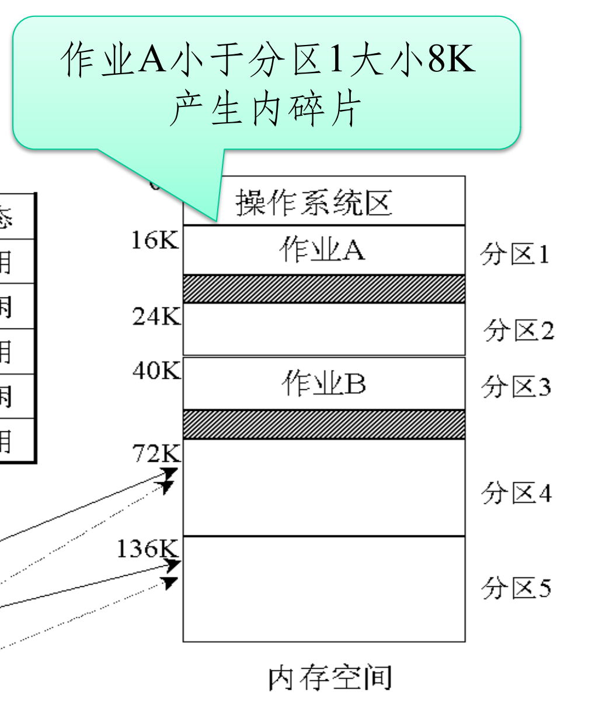
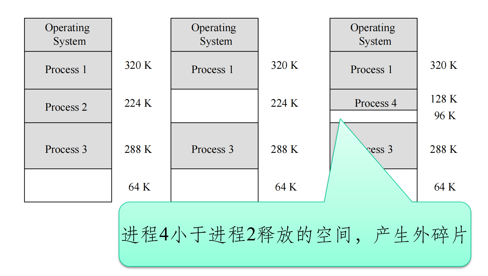
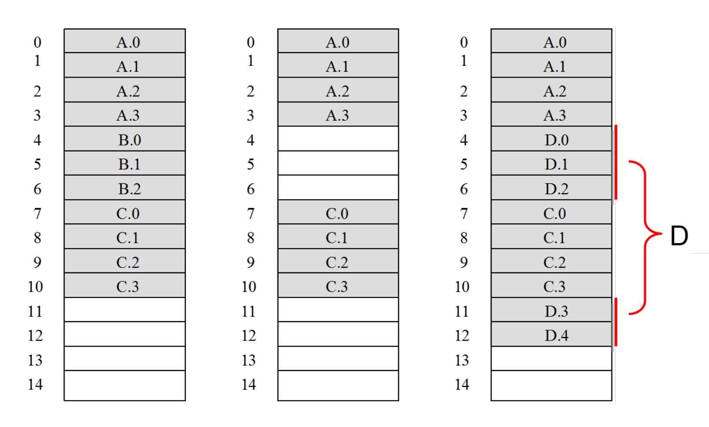
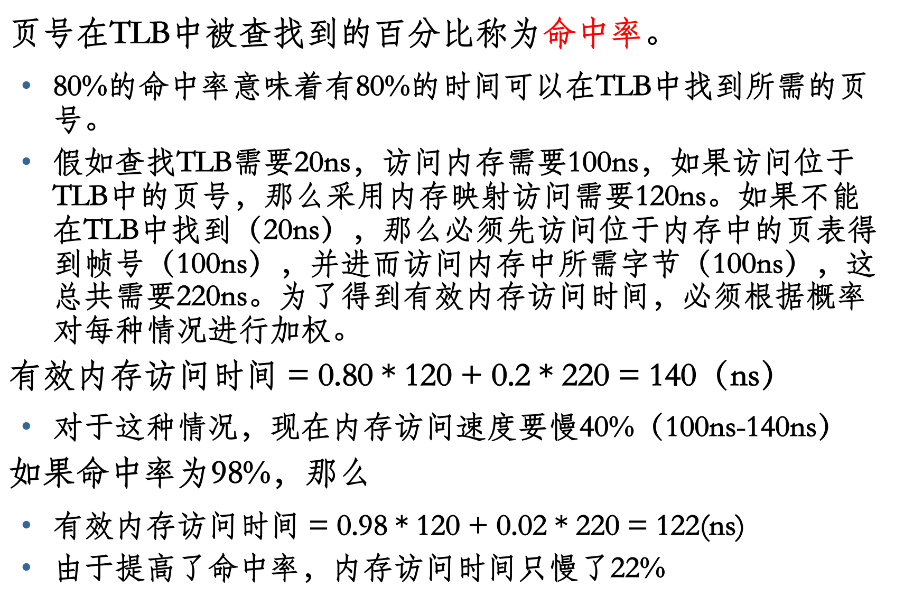
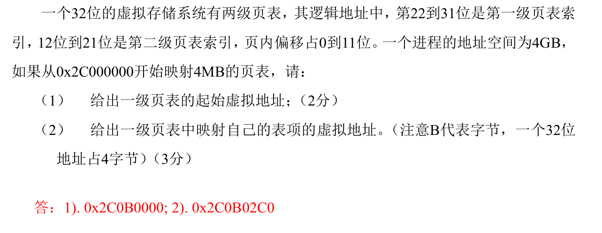

## 内存管理的不同空间
### 重定位
#### 编译时重定位

问题：如果程序要装入其他地址，必须重新编译-不灵活

#### 装载时重定位

装载时重定位，降低装载的速度，实现复杂，同时也缺乏保护。

#### 执行时重定位

问题：寄存器比较和相加产生时间开销

### 地址空间
- 物理地址空间
  - 内存中一系列存储信息的物理地址的集合
  - 内存通常以字节（每个字节为8个二进制位）为编址单位，每个字节都有一个地址与其对应。假定存储器的容量为n个字节，其地址编号顺序为0，1，2，…，n－1。这些地址称为“物理地址”。
- 逻辑地址空间
  - 对物理内存的抽象
  - 程序中使用的地址对应逻辑地址空间的地址
  - 不同进程的逻辑地址空间相互独立

逻辑地址在$0 \sim max$，物理基址$R$
- 物理地址在${R+0} \sim R+max$

用户在**程序**中使用**逻辑地址**，但用于**内存访问**前必须映射为**物理地址**

### 地址映射

- 从逻辑地址到物理地址的映射
- 通过存储管理单元（MMU）完成

## 程序的链接和装载

### 基础知识

一个装入内存的可执行程序，除了bss、data和text段外，还需构建一个栈(stack)和一个堆(heap)

.bss段与.data段的区别

| 特性                   | 程序1 (`int ar[30000];`)        | 程序2 (`int ar[300000] = {...};`) |
| :--------------------- | :------------------------------ | :-------------------------------- |
| **变量类型**           | 未初始化的全局变量              | 已初始化的全局变量                |
| **所在段**             | `.bss` 段                       | `.data` 段                        |
| **可执行文件中的存储** | 只记录大小，不存储具体值        | 存储所有元素的初始值              |
| **可执行文件大小**     | **很小** (几乎不受数组大小影响) | **很大** (与数组总大小成正比)     |
| **运行时内存占用**     | 加载时由系统分配并清零          | 从文件中加载初始值                |

栈(stack)：存放、交换临时数据的内存区
- 用户存放程序**局部变量**的内存区域，（但不包括static声明的变量，static意味着在数据段中存放变量）。
- 保存/恢复调用现场。在**函数被调用**时，其参数也会被压入发起调用的进程栈中，并且待到调用结束后，函数的返回值也会被存放回栈中。

堆（heap）：存放进程运行中动态分配的内存段
- 它的大小并不固定，可动态扩张或缩减。当进程调用malloc等函数**分配内存**时，新分配的内存就被动态添加到堆上（堆被扩张）；当利用free等函数释放内存时，被释放的内存从堆中被剔除（堆被缩减）。

## 存储管理基础

### 存储管理的需求
- 支持多道程序和多用户系统：
  - 针对多个应用，将内存划分多个区域
- 充分利用内存
- 方便用户使用：OS自动加载程序，对用户透明
- 较大的逻辑运行空间：不局限于物理内存大小
- 存储保护与共享

### 存储管理的功能
#### 分配和回收
- 当用户请求内存时，及时响应，**分配**内存
- 当用户不需要时及时**回收**内存，让其他用户使用
- 这就要求：
  - 用数据结构，记住内存分配状态
  - 分配：用户请求，分配内存，修改数据结构
  - 回收：用户释放内存，修改数据结构

#### 扩充容量
OS要方便用户使用-用户编程不需要考虑内存的容量
- 需要扩充内存容量，让用户可以用更大的空间

解决方案
- 在MMU内存管理单元的控制下
  - 交换技术
  - 虚拟存储技术:把内存和外存统一使用，扩充内存

#### 共享
让多个**进程共用内存**中的相同区域
**代码共享** 节省内存空间
**数据共享** 实现进程的通讯

### 连续分配存储管理方式

#### 单一连续分配方式

内存分为两个区域：系统区，用户区。应用程序装入到用户区，可使用用户区全部空间。
最简单，适用于单用户、单任务的OS。
优点：易于管理。
缺点：对要求内存空间少的程序，造成内存浪费；程序全部装入，很少使用的程序部分也占用内存。

#### 分区分配方式

把内存分为一些大小相等或不等的分区(partition)，每个应用程序占用一个或几个分区。操作系统占用其中一个分区。
适用于多道程序系统和分时系统，支持多个程序并发执行，但难以进行内存分区的共享。
- 进程属于不同分区

问题：内碎片和外碎片
- 内碎片：分区内部难以利用的空间
- 外碎片：分区之间难以利用的空间

分区式管理的方法：
- 数据结构：分区表或者分区链表
- OS负责维护数据结构

##### 固定式分区

固定式分区（静态存储区域）：当系统初始化时，把存储空间划分成若干个任意大小的固定区域；然后，把这些区域分配给每个用户作业。
把内存划分为若干个固定大小的连续分区。
- 分区大小相等：只适合于多个相似程序的并发执行（处理多个类型相同的对象）。
- 分区大小不等：多个小分区、适量的中等分区、少量的大分区。根据程序的大小，分配当前空闲的、适当大小的分区。

优点：易于实现，开销小。
缺点：
- **内碎片**造成浪费；
- 分区总数固定，**限制**了并发执行的程序**数目**；
- **灵活性差**，可接受程序大小受分区大小限制

采用的数据结构：分区表一一记录分区的大小和使用情况

##### 可变式分区

可变式分区：分区的边界可以移动，即分区的大小可变。
分区大小在程序装入时大小动态确定，量身定制
- 也可以通过系统调用改变分区大小

优点：没有内碎片。
缺点：随着多次分配和回收，产生**外碎片**。

###### 可变式分区的内存分配策略

1) 最佳适应算法（Best Fit）：为一个作业选择分区时，总是寻找其**大小最接近**于作业所要求的存储区域。
2) 最坏适应算法（Worst Fit）：为作业选择存储区域时，总是寻找**最大**的空白区。
3) 首次适应算法（First Fit）：每个空白区按其在存储空间中地址递增的顺序连在一起，在为作业分配存储区域时，从这个空白区域链的始端开始查找，选择**第一个**足以满足请求的空白块。
4) 下次适应算法（Next Fit）：把存储空间中空白区构成一个循环链，每次为存储请求查找合适的分区时，总是**从上次查找结束的地方的下一个分区开始**，只要找到一个足够大的空白区，就将它划分后分配出去。

回收区域空白区邻接的四种情况

##### 伙伴系统

介于固定分区与可变分区之间的动态分区技术。 动态划分和合并2的幂大小的分区。
伙伴：在分配存储块时将一个大的存储块分裂成两个大小相等的小块，这两个小块就称为“伙伴” 。

## 页式内存管理

### 分页式存储管理的基本思想

### 基本概念
页：在分页存储管理系统中，把每个作业的地址空间分成一些大小相等的片，称之为页面（Page）或页，各页从0开始编号。

存储块：在分页存储管理系统中，把主存的存储空间也分成与页面相同大小的片，这些片称为存储块，或称为**页框**（Frame），同样从0开始编号。

#### 页表

页表：为了便于在内存找到进程的每个页面所对应块，分页系统中为每个进程配置一张页表，进程逻辑地址空间中的每一页，在页表中都对应有一个页表项，实现**页面到页框的映射**。
- **存放在内存中**
- 使用页表后访问一个数据需访问内存 **2 次** (页表一次，内存一次)。
- 页表的**基址及长度**由页表寄存器给出。

将页表始址与页号和页表项长度的乘积相加，得到~~该表项在页表中的位置~~**页表项在内存中的地址**（是**物理地址**）（页表项由**物理块号**和权限位组成），于是可从中得到该页的物理块号，将之装入物理地址寄存器中。

#### 两级页表

将页表再进行分页，离散地将各个页表页面存放在不同的物理块中，同时也再建立一张更高层次页表（一级页表）用以记录页表页面对应的物理块号。
正在运行的进程，必须把一级页表（页表的页表）调入内存，而动态调入二级页表。（lazy allocation）
当一级页表的某一个条目为空，该条目对应的二级页表不需要调入内存（valid=0，没有映射，会触发page fault）

多级页表结构中，指令所给出的地址除页内偏移地址之外的各部分全是各级页表的页号，而各级页表中记录的全是**物理页框号**，指向下级页表或最终要访问的页框号。

> 二级页表为什么节省内存空间?
> 一级页表：32位地址，页面大小4K，需要一百万个（1M）页表项在内存中，每个页表项4字节，占4M
> 二级页表：4G空间，页面大小4K。一级页表1K项，每项代表4M空间。每个二级页代表1K项，每项代表4K页面。假设进程12M，一级页表只需要占用3项，所以二级页表只需要3个在内存，只需要4个页表(16K)在内存

#### 快表 TLB

快表是一种特殊的高速缓冲存储器（**Cache**） ，内容是页表中的一部分内容。
快表只是页表的一部分
- 容量小，成本可以接受
- 程序访存的局部性原理，大部分访存集中在少量的（页面）页表项

CPU 产生逻辑地址的页号，首先在快表中寻找，若命中就找出其对应的页框；若未命中，再到页表中找其对应的物理块，**并将之复制到快表**。若快表中内容满，则按某种算法淘汰某些页。

##### TLB 刷新问题

没有标签 $\rightarrow$ 进程切换必须刷新TLB

使用了ASID之后
- 切换页表不再需要刷新TLB
- 修改页表映射后，仍需刷新TLB

多核 略

##### 命中率

### 页表类型

#### 反置页表

#### 哈希页表

### 页共享

## 虚拟存储管理

### 虚拟存储器

虚拟存储器，~~是指具有请求调入功能和置换功能，能从逻辑上对内存容量加以扩充的一种存储器系统。~~ 该系统逻辑容量由内存容量和外存容量之和所决定；其运行速度接近于内存速度，成本接近于外存。

#### 基本原理
在程序装入时，不需要将其全部读入到内存，而**只需将当前需要执行的部分页或段读入到内存**，就可让程序开始执行。
在程序执行过程中，如果需执行的指令或访问的数据尚未在内存（称为缺页或缺段），则由处理器通知操作系统将相应的页或段调入到内存，然后继续执行程序。（请求调入功能）
另一方面，操作系统将内存中**暂时不使用的页或段调出保存在外存**上，从而腾出空间存放将要装入的程序以及将要调入的页或段。（置换功能）

#### 特征
- 多次性：作业被分成多次调入内存运行。正是由于多次性，虚拟存储器才具备了逻辑上扩大内存的功能。多次性是虚拟存储器最重要的特征。
- 对换性：允许在作业运行过程中进行换进、换出。换进、换出可提高内存利用率。
- 离散性：物理内存分配的不连续；虚拟地址空间使用的不连续（如数据段和栈段之间存在空闲空间，共享段和动态链接库占用的空间）
- 虚拟性：通过物理内存和外存相结合，提供大范围的虚拟地址空间

#### 优点、代价和限制
优点：
- 可在较小的可用内存中执行较**大**的用户程序；
- 可在内存中容纳更**多**程序并发执行；
- 不必影响编程时的程序结构（与覆盖技术比较）
- 提供给用户可用的虚拟内存空间通常大于物理内存(real memory)

代价：虚拟存储量的扩大是以牺牲 CPU 工作**时间**以及内外存交换时间为代价。
限制：虚拟存储器的容量取决于主存与辅存的容量，也受限于计算机的地址结构决定。如 32 位机器，虚拟存储器的最大容量就是 4G。

## 自映射

页表存储在内存中
- 每个页表项需要4字节，所以1M个页表项需要4MB字节存储，所以整个页表占用的内存大小就是4MB
- 4MB页表也要分页存储，共需要4MB/4KB=1024个页面存储（我们把存放页表的页称为:**页表页**）

页表也被映射到进程的4G逻辑地址空间内
- 操作系统把页表所在的物理内存，映射到内核虚拟地址空间（kernel space）
  - 好处：统一访问方式 $\rightarrow$ 和其他内存访问方式一致，不用关MMU
  - 方便修改页表
- 进程的4GB虚拟地址空间，有一部分留给内核空间（通常 1GB），并且在所有进程中共享
  - 避免进入内核态切换页表，方便内核访问所有进程资源

