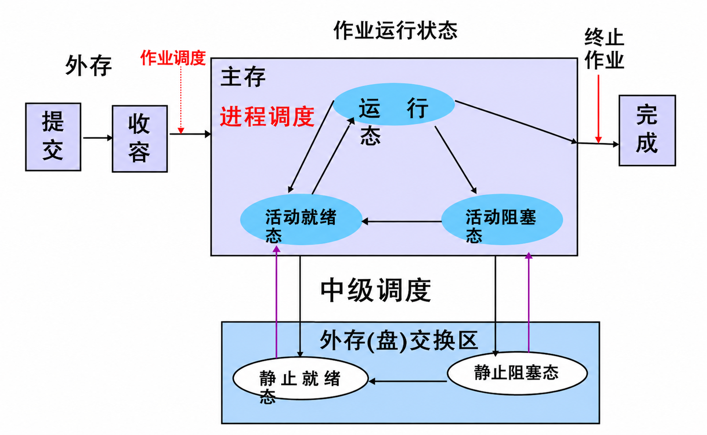
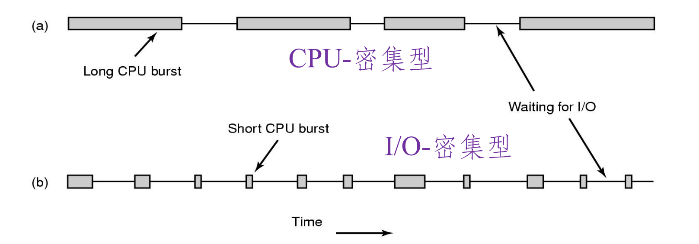
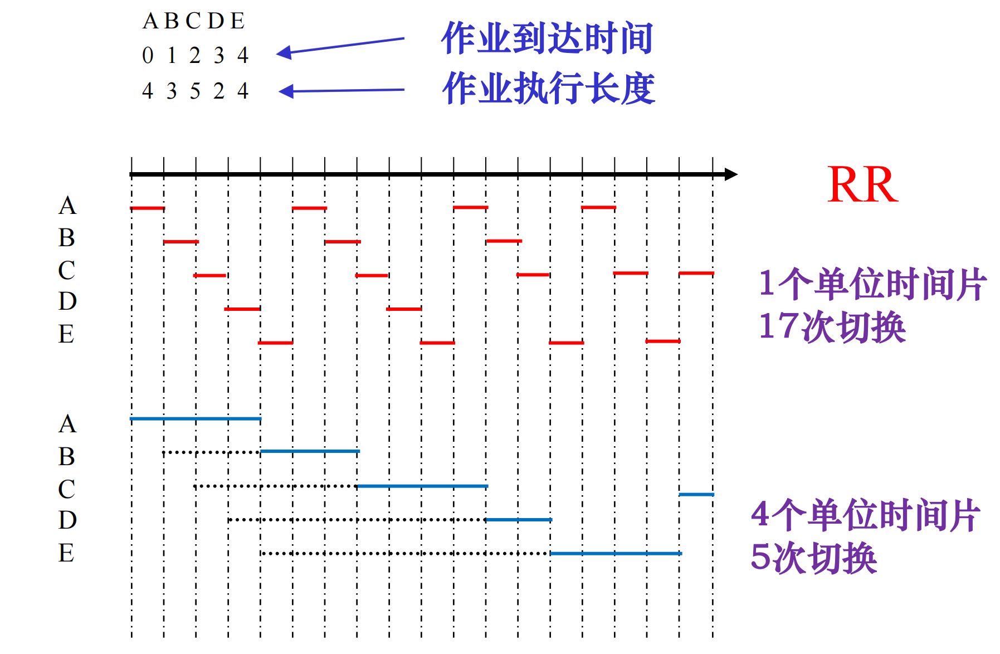
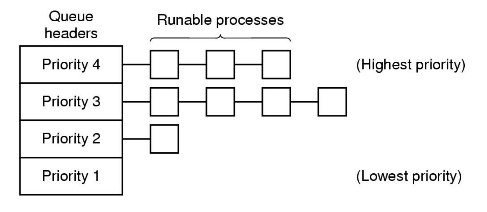
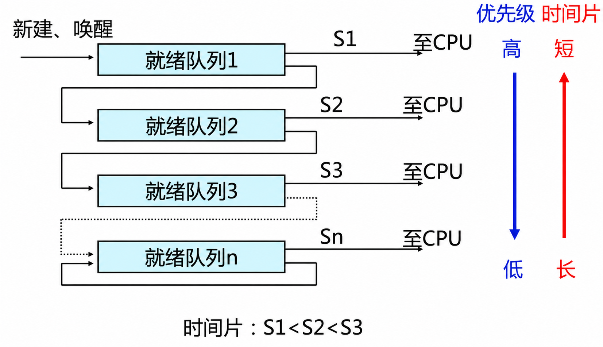
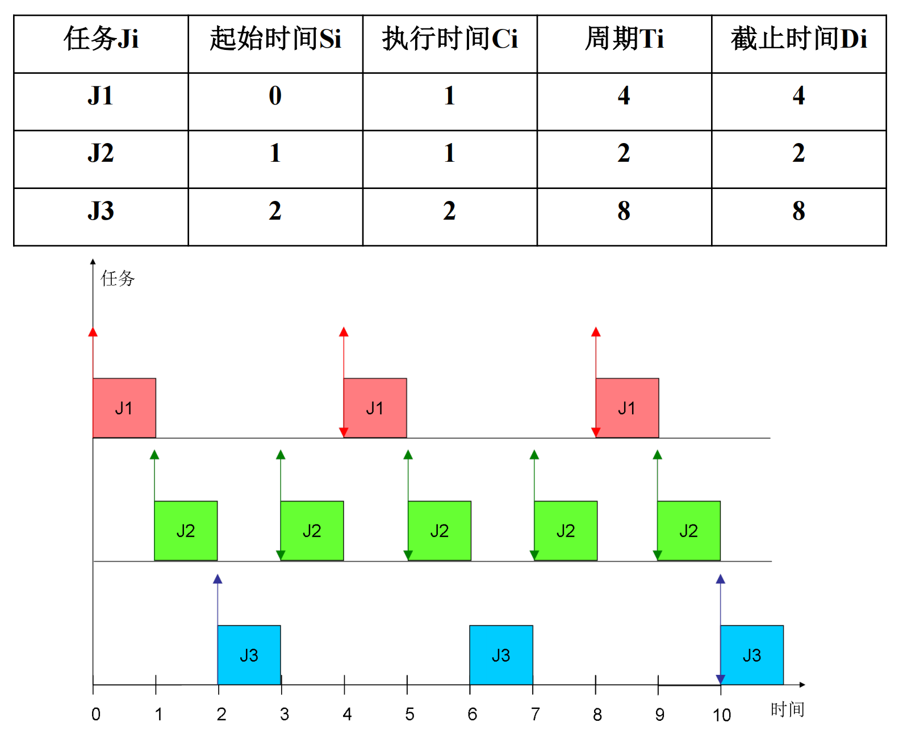

# 进程调度

## 基本概念

### CPU调度

CPU 调度（CPU Scheduling）的任务是协调多个进程（或线程）对 CPU 的竞争。

本质：按照某种调度策略，从就绪队列中选择一个实体执行。

典型场景：
- N 个进程处于就绪态，等待 CPU；
- 系统有 M 个 CPU（M >= 1）；
- OS 必须决定“哪个进程使用哪个 CPU”。

什么时候调度最有价值？
- 当 CPU 是稀缺资源时。
- 多道程序分时系统、服务器场景、主机系统通常更依赖调度质量。

### 进程状态与调度触发

三态模型：就绪、运行、阻塞。

常见调度时机：
- **新进程创建**后（父子谁先运行）；
- 进程运行结束；
- 进程因 I/O/信号量等原因阻塞；
- I/O 中断完成，阻塞进程转就绪；
- 时钟中断到来（时间片用完）。

只要 OS 重新获得 CPU 控制权，就可能发生切换：
- 用户态系统调用（可能阻塞）；
- 外部中断；
- 异常/陷阱（如非法访问）。

### 调度执行与上下文切换

一次切换通常包括：
- 保存当前进程 CPU 上下文（PC、寄存器等）；
- 保存/更新内存映像信息（如页表）；
- 更新当前 PCB 状态并入对应队列（就绪/阻塞）；
- 选择下一个可运行进程；
- 恢复其上下文并切换执行。

> 上下文切换有开销（寄存器保存恢复、缓存/TLB影响、内核路径），应避免无意义的频繁切换。

### 传统三级调度

高级调度（宏观/作业调度）：从**用户**工作流程的角度，一次提交的若干个作业，对每个作业进行调度。
- 决定接纳哪些作业、接纳多少；
- 时间尺度通常为分钟/小时/天。

中级调度（内外存交换）：从**存储器资源**的角度。将进程的部分或全部换出到外存上，将当前所需部分换入到内存。
- 决定进程换入换出，缓解内存压力。

低级调度（微观/进程或线程调度）：从**CPU资源**的角度，执行的单位。
- 直接分配 CPU；
- 时间尺度通常为毫秒，频繁且要求实现高效。

## 调度算法设计要考虑的问题

### 进程类型

I/O 密集型（I/O-bound）：
- CPU burst 短，频繁等待 I/O。

CPU 密集型（CPU-bound）：
- 计算为主，CPU burst 长。

### 调度分类

按是否抢占：根据是否在时钟中断作出调度决策
- 非抢占式：进程主动放弃或阻塞后才切换；
- 抢占式：时钟中断到达可强制切换。

按应用领域：根据不同的应用领域，优化目标不同
- 批处理系统：追求吞吐量与平均周转；
- 交互式系统：追求响应时间；
- 实时系统：追求截止时间可满足性和可预测性。

### 目标与评价指标

通用目标：
- 公平性：给每个进程公平的CPU份额
  - 相似的进程应该得到相似的CPU份额
  - 不同类型的进程可以有区别
    核反应控制 v.s. 薪水计算
- 策略可执行：必须能够严格执行策略
- 平衡性：让 CPU/I/O 等资源尽量都忙起来

批处理常用指标：
- 吞吐量：单位时间（每小时）完成**作业数**
- 周转时间：完成时刻 - 提交时刻
- 带权周转时间：周转时间 / 服务时间（执行时间）
- 平均周转时间：$\bar{T}=\frac{1}{n}\sum_{i=1}^{n}T_i$
- 平均带权周转时间：$\bar{W}=\frac{1}{n}\sum_{i=1}^{n}\frac{T_i}{T_{s,i}}$
- CPU利用率
  - 常常被用做评估批处理系统的指标
  - 不如吞度量有效
  - CPU利用率接近100% -> 需要购买额外的硬件了

交互式目标：
- 最小化响应时间：用户输入一个请求（如击键）到系统给出首次响应（如屏幕显示）的时间
- 等比例变化：任务花费时间随任务复杂度“近似线性”增长，避免卡顿和长尾。

实时系统目标：
- 满足截止时间：满足所有或者大多数应用的截止时间
  - 例如飞控系统需要100ms内完成飞行控制命令
- 可预测性：保证可预测性和确定性
  保证最坏情况可预测，而不只是平均快。

调度算法本身的目标
- 易于实现
- 执行的性能开销小

### 时间片（Time Slice / Quantum）

一个时间段，分配给调度上CPU的进程，以确定允许该进程运行的时间长度。

时间片设置的权衡：
- 太短：切换频繁，系统开销大；
- 太长：响应变差，交互体验下降。

经验：
- 一般在“响应性”和“切换开销”之间取折中（如几十 ms 量级）。

## 批处理系统调度算法

### 先来先服务 FCFS

基本思想：按到达先后进入就绪队列，队首先执行（非抢占）。

特点：
- 优点：简单、公平、易实现；
- 缺点：短作业可能被长作业拖慢（护航效应），平均周转可能偏大。

### 最短作业优先 SJF

基本思想：优先选择估计运行时间最短的作业（非抢占）。

特点：
- 优点：在作业同时就绪时，可显著降低平均周转时间；
- 缺点：长作业可能长期等待；执行时间难以精准预测。

> 结论：在可预估运行时间的前提下，SJF 对平均周转时间通常优于 FCFS。

### 最短剩余时间优先 SRTN

SJF 的抢占式版本：
- 当新到达作业的“剩余时间”小于当前运行作业时，立即抢占。

特点：
- 优点：对短任务更友好；
- 缺点：若短任务源源不断，长任务可能饥饿。

### 最高响应比优先 HRRN

折中思想：同时考虑等待时间和服务时间。

响应比：
- $RP = 1 + \frac{等待时间}{服务时间}$

特点：
- 短作业通常响应比高，容易先执行；
- 长作业等待足够久后响应比也会提升，能抑制饥饿；
- 需每次调度前计算响应比，有额外开销。

## 交互式系统调度算法

### 时间片轮转 RR

基本思想：
- 所有就绪进程按 FCFS 排队；
- 每次给队首一个时间片；
- 时间片到且未完成则移到队尾。

特点：
- 公平、简单、响应性较好；
- 性能高度依赖时间片大小。

### 优先级调度

给每个进程分配优先级，高优先级优先执行。

静态优先级：创建时确定，运行中不变。依据：
- 进程类型（系统进程和交互进程优先级较高）
- 对资源的需求（对CPU和内存需求较少的进程，优先级较高）
- 用户要求（紧迫程度和付费多少）

动态优先级：
- 可根据等待时长、近期 CPU 使用、I/O 行为动态调整；
- 常用于兼顾响应性与公平性。

潜在问题：
- 低优先级进程可能长期得不到 CPU（饥饿）。

### 多级队列 MQ

思想：
- 按任务类型划分多个就绪队列；
- 队列间按优先级调度，队列内可用 FCFS 或 RR。

问题：

- 饥饿 
  - 高优先级队列一直有进程
  - 低优先级队列永远得不到CPUà饥饿

- 优先级静态
  - 优先级不会变化 -> 错误的分配无法纠错

- 对进程行为“不敏感”
  - I/O密集v.s.交互进程v.s.CPU密集 -> 无法区别对待
  - 预先难以知道进程对执行时间的要求

### 多级反馈队列 MFQ

思想：

1.  **分级与特征**：设置多个优先级队列。**优先级越高，时间片越短**（等级越高，给你的时间越少）。
2.  **降级机制**：新进程先入最高级队列。若在当前时间片内**未执行完，则降入下一级**队列末尾。
3.  **抢占规则**：始终优先执行高优先级队列。若有新进程进入高级队列，**立即抢占**当前正在执行的低级进程。

I/O型进程：让其进入最高优先级队列，以及时响应I/O交互。通常执行一个时间片，要求可处理完一次I/O请求的数据，然后转入到阻塞队列。
计算型进程：每次都执行完时间片，进入更低级队列。最终采用最大时间片来执行，减少调度次数。
为适应一个进程在不同时间段的运行特点，I/O完成时，提高优先级；时间片用完时，降低优先级；

特点：
- 兼顾响应性与吞吐；
- 可以在不了解任务时长时自适应区分任务类型；
- 是 RR + 优先级 + 动态调整的综合。

### 彩票调度与 Stride 调度

彩票调度（Lottery Scheduling）：
- 通过“彩票张数”按概率分配 CPU；
- 长期看资源份额接近权重比例，短期有随机波动。

Stride 调度：
- 彩票调度的确定性近似；
- $stride = MaxStride / ticket$；
- 每次选 pass 最小者运行，并更新 pass。

特点：
- 更容易做按权重公平共享；
- 相比随机抽签，短期公平性更稳定。

### Linux CFS（Complete Fair Scheduler）

核心思想：
- 模拟“理想公平 CPU”，让每个任务按权重公平推进。

关键量：
- $vruntime = 运行时间 / 权重$
- 每次选择 vruntime 最小的实体运行（优先补偿“落后者”）。

实现要点：
- CFS 运行队列常用红黑树按 vruntime 排序；
- 最左节点（最小 vruntime）优先调度。

## 实时系统调度

### 实时系统与任务模型

实时系统强调“按时正确”：迟到结果可能比错误更糟。

分类：
- 硬实时：必须满足截止时间；
- 软实时：允许小比例超时。

周期任务集常见表示：
- 任务 $\tau_i$ 周期 $T_i$，执行时间 $C_i$，截止期 $D_i$（通常 $D_i=T_i$）。

CPU 利用率：
- $U=\sum_{i=1}^{n}\frac{C_i}{T_i}$

### 静态表调度

离线分析并生成固定调度表，运行时按表执行。

特点：
- 运行开销小；
- 灵活性差，只适用于完全固定的任务场景。

### 单调速率调度 RMS

RMS（Rate Monotonic Scheduling）是单处理器下的最优**静态**调度算法

规则：
- 周期越短（频率越高）优先级越高；
- 固定优先级、**可抢占**。

特点：
- 经典静态优先级实时调度算法；
- 易分析、易实现；
- 利用率较高时可能不可调度。

### 最早截止时间优先算法 EDF

EDF（Earliest Deadline First）是单处理器下全局最优调度算法

规则：
- 谁的绝对截止时间最近，谁优先。

特点：
- 动态优先级；
- 单处理机下可达到更高可调度性（理论上当 $U<=1$ 时可调度）。

> 实时系统核心不是“平均快”，而是“最坏情况可保证”。

## 多处理机调度

### 与单处理机调度的差异

多处理机更关注：
- 系统整体吞吐与负载均衡；
- 调度数据结构并发访问的互斥开销；
- 线程通常是更常见的调度单位。

### AMP 与 SMP

AMP（非对称多处理）：
- 主从结构，主处理机负责调度与管理。
- 各个处理机有固定分工，如一个处理机执行 OS 的系统功能，另一个处理 I/O。

SMP（对称多处理）：
- 处理机地位对等，常见三类策略：
- 静态分配：任务绑定某 CPU，迁移少但可能失衡；
- 动态分配：公共队列，空闲 CPU 取任务；
- 自调度：各 CPU 自行从共享队列取任务（常用，但锁竞争可能成瓶颈）。

### 成组调度与专用处理机分配

成组调度（Gang Scheduling）：
- 将同一并行任务的多个线程成组同时调度。
- 适合线程间强协作，减少同步等待。

专用处理机分配（Dedicated Processor Assignment）：
- 为某些关键并行任务保留处理机资源。
- 有利于稳定性能与通信局部性，但资源弹性较差。

### 机制与策略分离

思路：
- 内核提供通用调度机制；
- 上层通过参数/权重/优先级接口表达策略。

意义：
- 让“最了解业务目标”的应用参与调度意图表达；
- 在公平、吞吐、响应等目标间更灵活折中。
