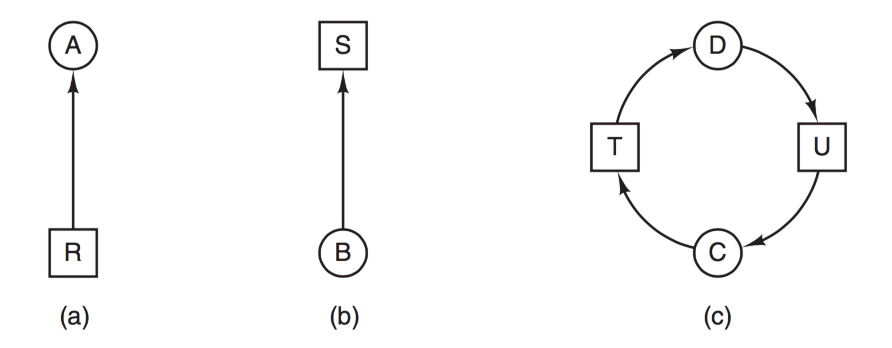

# 死锁

## 死锁的概念

### 死锁定义

死锁（Deadlock）：
如果一个进程集合中的每个进程都在等待只能由该进程集合中其他进程才能引发的事件，那么这个进程集合就是死锁的。

死锁的根本特征：
- 每个进程都在等待；
- 每个进程等待的条件，都依赖于同一组进程中的其他进程；
- 没有外力介入时，这种等待会一直持续下去。

#### 资源死锁：

如果每个进程等待的事件，都是**释放**该进程集合中其他进程所占有的**资源**，则称为资源死锁。

#### 通信死锁

例子：
- 进程 `A` 向进程 `B` 发送请求消息；
- `A` 发送后阻塞，等待 `B` 回复；
- 若该请求消息丢失，则 `A` 一直等回复；
- 而 `B` 根本没收到消息，也可能一直等新的请求；
- 于是形成通信死锁。

特点：
- 不一定涉及“占有资源不放”；
- 更难单纯靠调度避免；
- 常通过**超时与重传机制**避免。

### 死锁、饥饿、活锁

死锁不等于饥饿，也不等于活锁。

饥饿（Starvation）：
- 某个进程长期得不到所需资源或调度机会，因此一直无法推进。
- 例如读者优先的读者-写者问题中，写者可能长期得不到执行机会，这叫饥饿，不叫死锁。

活锁（Livelock）：
- 两个或多个线程不断改变状态、互相谦让，但谁都无法真正向前推进。
- 例如两个线程同时释放锁、同时重试、再次同时冲突，反复循环。
- 避免活锁的常见方法：引入随机退避时间（解锁之前，等待一个随机时间）。

### 死锁发生的原因

死锁通常由两类原因引起：
- 竞争资源；
- 并发执行顺序不当。

典型例子：

进程 `P1`
- 先申请文件 `F`
- 再申请打印机 `T`

进程 `P2`
- 先申请打印机 `T`
- 再申请文件 `F`

若 `P1` 已拿到 `F` 等待 `T`，同时 `P2` 已拿到 `T` 等待 `F`，就会形成死锁。

### 竞争资源引发死锁

#### 可剥夺资源与不可剥夺资源

可剥夺资源：
- 进程获得后，系统或其他进程可以强行夺走。
- 如 CPU、部分内存资源。

不可剥夺资源：
- 一旦分配给某进程，就不能强行收回，只能由进程用完后主动释放。
- 如打印机、刻录机。

#### 临时性资源

临时性资源也叫消耗性资源：
- 由一个进程产生，被另一个进程使用；
- 使用后很快失去意义。

例如：
- 消息；
- 中断；
- 通信数据包。

这类资源同样可能导致死锁。

例如三个进程：
- `P1` 等待 `P3` 的消息 `S3`，自己掌握 `S1`
- `P2` 等待 `P1` 的消息 `S1`，自己掌握 `S2`
- `P3` 等待 `P2` 的消息 `S2`，自己掌握 `S3`

若大家都先请求、后释放，就可能形成环路等待并发生死锁。

#### 资源死锁的必要条件

1. 互斥条件：指进程对所分配到的资源进行排它性使用，即在**一段时间内某资源只能有一个进程占用**。
2. 保持和请求条件：已经获得资源的线程可以请求新的资源
3. 不剥夺条件：指进程已获得的资源，在未使用完之前不能被强制剥夺，只能在使用完时由自己释放。
4. 环路等待条件：指在发生死锁时，必然存在两个或多个进程组成的环形链，每个进程都在等待环形链中下一个节点占用的资源。

## 处理死锁的基本方法

处理死锁的思路主要有四类：
- 鸵鸟算法：忽略死锁；
- 死锁检测与恢复：允许发生，再检测并解除；
- 死锁预防：破坏死锁的四个必要条件之一；
- 死锁避免：动态判断分配后是否仍安全，只在安全时分配。

> 越早对死锁下手，通常对系统性能影响越大。
> 像 Unix 这类重视性能的系统，通常不采用代价较高的预防/避免，而更倾向于检测与恢复。

### 鸵鸟算法

鸵鸟算法：
- 无视死锁的存在，假设它很少发生；
- 一旦发生，由人工重启、杀进程等方式处理。

适用场景：
- 死锁发生概率低；
- 死锁影响范围小；
- 系统更看重性能和实现简单性。

## 死锁检测与恢复

### 死锁检测

死锁检测的核心思想：
- 根据资源请求和资源分配信息，判断系统中是否存在循环等待。

常见方法：
- 资源分配图法；
- 资源向量/矩阵法。

#### 资源分配图

资源分配图（Resource Allocation Graph, RAG）中：
- 圆形结点表示进程；
- 方形结点表示资源；
- 资源 `->` 进程：资源已分配给该进程；
- 进程 `->` 资源：该进程正在请求该资源。



##### 每个资源只有一个实例

若每类资源都只有一个实例，则：
- 图中**有环**，当且仅当系统中**发生死锁**。

因此可以：
- 按请求/释放资源的过程更新图；
- 每次更新后检查图中是否存在环。

##### 多实例资源的资源分配图化简

当每类资源有多个实例时，仅仅“有环”不再是死锁的充要条件，需要看图能否化简。

封锁进程：请求量超过当前可用资源数，暂时无法满足的进程。

非封锁进程：其请求量不超过当前可用资源数的进程。

化简思想：
- 寻找一个非封锁进程 `Pi`；
- 先假设系统将其请求满足（请求边变成分配边）；
- `Pi` 在有限时间内执行结束并释放全部资源；
- 删除 `Pi` 的请求边和分配边；
- 重复以上过程。

死锁定理：
- 某时刻系统处于死锁状态，当且仅当此时资源分配图**不可完全化简**。

#### 资源向量（矩阵）算法

适用于每类资源有多个实例的情况。

定义：

- `E`：存在资源向量（Existing），表示各类资源总量；
- `A`：可用资源向量（Available），表示当前未分配资源数；
- `C`：当前分配矩阵（Current Allocation），第 `i` 行表示进程 `Pi` 已占有的各类资源数；
- `R`：请求矩阵（Request），第 `i` 行表示进程 `Pi` 仍请求的各类资源数。

检测算法思想：

1. 寻找某个进程 `Pi`，满足 `R_i <= A`
2. 若找到，则认为 `Pi` 可完成，把 `C_i` 归还给系统：
   `A = A + C_i`
3. 标记 `Pi` 完成，继续寻找下一进程
4. 若再也找不到满足条件的进程，则算法结束
5. 若仍有未标记进程，则这些进程就是死锁进程

本质：
- 反复寻找“还能完成”的进程；
- 若最终有人永远无法被满足，则系统存在死锁。

### 死锁恢复

检测到死锁后，可以采用以下方法恢复：

#### 资源抢占法

- 挂起一些占有资源的进程；
- 强行剥夺其资源；
- 把资源分配给其他死锁进程，使其先完成；
- 再恢复被挂起的进程。

问题：
- 资源未必适合抢占；
- 实现复杂；
- 可能带来一致性问题。

#### 杀死进程法

- 杀死一个或多个进程，释放其资源；
- 打破死锁环。

选择策略可以考虑：
- 优先杀死代价小的进程；
- 优先杀死可重启、无副作用的进程。

例如：
- 编译进程：通常可以杀死重来；
- 数据库事务进程：可能有副作用，要谨慎；
- 打印进程：可能造成输出混乱。

#### 回滚法

思想：
- 系统定期设置检查点（checkpoint）；
- 检测到死锁后，把某个进程回滚到“尚未占用关键资源”的状态；
- 释放其资源，让其他进程推进。

特点：
- 常见于事务系统和容错系统；
- 需要额外的检查点**存储开销**；
- 本质上也常用于故障恢复。

## 死锁预防

死锁预防：
- 通过破坏四个必要条件之一，使死锁不可能发生。

### 1. 打破互斥条件

思路：
让某些资源变成可共享资源。

局限：
很多资源天然是互斥的，如打印机、独占设备。

典型做法：
使用**假脱机技术（Spooling）**，把独占设备改造成逻辑上的共享设备。

### 2. 打破保持和请求条件

常见策略：
- 进程开始执行前，一次性申请所需全部资源；
- 若申请不到全部资源，则一个也不分配。

或：
- 进程申请新资源前，先释放当前已占有资源，再重新申请全部需要的资源。

优点：
- 不会出现“拿着一部分资源再等另一部分资源”的情况。

缺点：
- 很多程序事先并不知道完整资源需求（因为在许多情况下，进程在执行时是动态的，不可预测的）；
- 资源利用率低；
- 降低并发度。

### 3. 打破不可抢占条件

思路：
允许系统在必要时强行剥夺资源。

问题：
- 对很多独占设备不现实；
- 可能导致执行结果异常。

例如：
- 正在打印时抢占打印机，输出可能直接损坏。

### 4. 打破循环等待条件

最经典的方法：**资源有序分配法**

做法：
- 对系统中的所有资源统一编号；
- 规定所有进程必须按编号递增顺序申请资源。

这样做的效果：
- 不可能形成环形等待链；
- 因而可以预防死锁。

例子：
- `PA` 需要按顺序使用 `R1 -> R2`
- `PB` 原本想按 `R2 -> R1` 使用
- 若强制资源编号顺序申请，则 `PB` 也必须按 `R1 -> R2` 申请
- 环路等待被破坏

缺点：
- 资源编号本身不容易设计；
- 限制进程申请资源的灵活性；
- 可能导致某些暂时不用的资源也要提前申请，增加占用时间。

### 哲学家进餐问题

#### 问题描述

5 个哲学家围坐在圆桌旁，桌上有 5 支筷子。

规则：
- 每个哲学家需要同时拿到左、右两支筷子才能吃饭；
- 吃完后放下筷子，继续思考。

抽象代码：

```python
while True:
    think()
    get_forks()
    eat()
    put_forks()
```

它是死锁问题的经典模型。

#### 直接做法为何会死锁

若每个哲学家都先拿右边筷子，再拿左边筷子：

```python
def get_forks(i):
    fork[right(i)].wait()
    fork[left(i)].wait()
```

那么可能出现：
- 5 个哲学家同时各拿起一支右边的筷子；
- 然后都等待左边那支；
- 形成循环等待，发生死锁。

#### 常见解法

##### 方法1：最多只允许 4 个哲学家同时尝试拿筷子

增加信号量 `diners = 4`：

```python
diners = Semaphore(4)

def get_forks(i):
    diners.wait()
    fork[right(i)].wait()
    fork[left(i)].wait()

def put_forks(i):
    fork[right(i)].signal()
    fork[left(i)].signal()
    diners.signal()
```

作用：
- 保证至少有一个哲学家最终能拿到两支筷子；
- 破坏了**循环等待**条件。

##### 方法2：改变拿筷子顺序

例如：
- 奇数号哲学家先拿左边，再拿右边；
- 偶数号哲学家先拿右边，再拿左边。

效果：破坏**循环等待**条件。

##### 方法3：按资源编号有序申请

给筷子编号，哲学家总是先拿编号小的，再拿编号大的。

本质：
- 资源有序分配法；
- 破坏**循环等待**条件。

##### 方法4：要么同时拿两支，要么一支也不拿

效果：破坏**保持和请求**条件。

Tanenbaum 算法

```python
state = [' thinking '] * 5
sem = [Semaphore(0) for i in range(5)]
mutex = Semaphore (1)

def get_fork(i):
    mutex.wait()
    state[i] = 'hungry'
    test(i)
    mutex.signal()
    sem[i].wait()

def put_fork(i):
    mutex.wait()
    state[i] = 'thinking'
    test(right(i))
    test(left(i))
    mutex.signal()

def test(i):
    if state[i] == 'hungry' and \
       state[left(i)] != 'eating' and \
       state[right(i)] != 'eating':
        state[i] = 'eating'
        sem[i].signal()
```

#### 注意

某些算法可以避免死锁，但仍可能产生饥饿。

也就是说：
- “不会卡死”不等于“每个人都公平地最终吃到饭”。

## 死锁避免

死锁避免：
- 不直接破坏死锁必要条件；
- 允许系统处于可能产生死锁的结构中；
- 但在每次资源分配前动态判断：分配后系统是否仍然安全；
- 只有在安全时才真正分配资源。

它比死锁预防更灵活，但实现代价更高。
假设(限制)：需要事先知道进程请求的所有资源

### 安全序列

安全序列：
- 系统中的所有进程能够按照某种顺序，依次获得所需资源、执行完毕并释放资源；
- 这样的进程序列称为安全序列。

若存在安全序列，则系统处于安全状态。

### 安全状态与不安全状态

安全状态：
- 当前没有死锁；
- 并且即使各进程都按其最大需求申请资源，系统仍然**存在某种调度顺序**，使所有进程都能完成。

不安全状态：
- 不存在这样的安全序列。

注意：
- 不安全状态**不一定**产生死锁（因为不一定按最大需求申请资源）；
- 但一旦死锁，系统一定处于不安全状态。

### 银行家算法

银行家算法（Banker's Algorithm）是最经典的死锁避免算法。

核心思想：
- 像银行发放贷款一样，系统在每次分配资源前都先判断：
- 若这次分配后还能保证“最终所有进程都能完成”，则批准；
- 否则拒绝本次分配，让进程等待。

#### 基本前提

银行家算法要求：
- 每个进程在**开始时就声明最大资源需求**；
- 已分配资源最终会释放；
- 系统能够跟踪各类资源的总量、已分配量和剩余量。

#### 关键数据结构

- `Available`：当前系统可用资源向量；
- `Max`：最大需求矩阵；
- `Allocation`：当前分配矩阵；
- `Need`：尚需资源矩阵。

其中：

`Need = Max - Allocation`

#### 资源请求算法

设 `Request_i` 为进程 `Pi` 的请求向量，系统按如下步骤处理：

1. 若 `Request_i <= Need_i`，继续；否则说明请求超过最大声明，出错。
2. 若 `Request_i <= Available`，继续；否则当前资源不足，`Pi` 等待。
3. 试探性分配：

```text
Available  = Available  - Request_i
Allocation = Allocation + Request_i
Need       = Need       - Request_i
```

4. 执行安全性算法：
- 若分配后系统仍安全，则正式分配；
- 否则撤销本次试探分配，让 `Pi` 等待。

#### 安全性算法

设置：
- `Work = Available`
- `Finish[i] = false`

循环执行：

1. 找到某个 `Pi`，满足：
   - `Finish[i] == false`
   - `Need_i <= Work`
2. 若找到，则假设 `Pi` 执行结束并释放资源：

```text
Work = Work + Allocation_i
Finish[i] = true
```

3. 重复寻找下一进程
4. 若最终所有 `Finish[i]` 都为 `true`，则系统安全；否则系统不安全

#### 银行家算法的特点

优点：
- 允许互斥、部分分配和不可剥夺存在；
- 比“死锁预防”更灵活，资源利用率更高。

缺点：
- 必须预先知道最大资源需求；
- 现实系统中很多程序很难准确给出最大需求；
- 算法本身有额外运行开销。

## 典型错误回顾

### Rendezvous 中的死锁写法

若两个线程都把 `signal` 放在 `wait` 之后，就可能彼此等待，导致死锁。

说明：
- 同步原语的顺序写错，也可能导致死锁；
- 这类问题本质上仍然是“等待环”。

### 生产者-消费者中的死锁写法

如果把生产者写成：

```c
P(mutex);
P(empty);
```

而不是先 `P(empty)` 再 `P(mutex)`，就可能导致死锁：
- 生产者先拿到 `mutex`；
- 再因缓冲区满而阻塞在 `empty`；
- 消费者想进入缓冲区又必须申请 `mutex`；
- 于是双方互相等待。

这说明：
- 对多个信号量/锁的申请顺序不当，是死锁的常见来源。

