# 进程与线程

## 进程

### 并发与并行

并发Concurrent：设有两个活动a1和a2，如果在某一指定的时间t，只要a1和a2都处在各自的起点和终点之间的某一处，则称a1和a2是并发执行的。

程序的并发执行是指若干个程序（或程序段）**同时**在系统中运行，这些程序（或程序段）的执行在时间上是重叠的。

并行Parallel：如果考虑两个程序,它们在同一时间度量下**同时运行在不同的处理机（或核心）上**，则称这两个程序是并行执行的。
- 并行一定并发，反之不然

#### 程序的顺序执行与特征
顺序性：按照程序结构所指定的次序（可能有分支或循环）
封闭性：独占全部资源，计算机的状态只由于该程序的控制逻辑所决定
可再现性：初始条件相同则结果相同。

#### 程序并发执行时的特征
间断性：并发程序具有“执行---暂停---执行”这种间断性的活动规律。
非封闭性：多个程序共享系统中的资源（如共享内存），这些资源的状态将由多个程序来改变，致使程序之间相互影响。
不可再现性：在所有输入相同的情况下，程序的执行结果还依赖于执行的次序。

原因：调度产生了不确定性，发生了**数据竞争**：
- 数据竞争：多个进程在没有同步保护的情况下访问同一个共享变量， 而且至少有一个是写。
- 数据竞争非常难以循环调试：每次执行不确定，调试的时候可能会消失，Heisenbug。

> 数据竞争，原子性违反，死锁是三类典型的并发错误

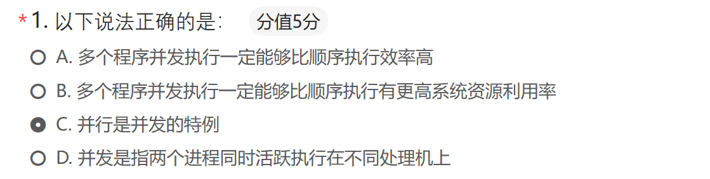

#### Bernstein条件

并发进程的无关性是进程与时间无关的一个**充分**条件，这一条件在1966年首先由Bernstein提出，称为Bernstein条件。

定义：

- R(Si)：Si的读子集，其值在Si中被引用的变量的集合
- W(Si)：Si的写子集，其值在Si中被改变的变量的集合

Bernstein条件：

- 两个进程S1和S2可并发，当且仅当下列条件同时成立：
  - $R(S1) \cap W(S2) = \Phi$
  - $W(S1) \cap R(S2) = \Phi$
  - $W(S1) \cap W(S2) = \Phi$

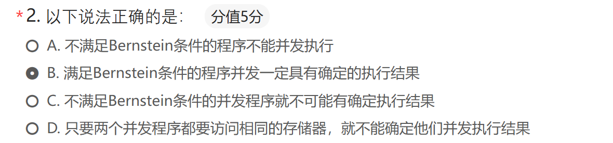

### 进程概念

> “程序”与“计算”不是一一对应的关系：一个程序段可能对应多个“计算”
> 多道程序＋资源的限制：执行-暂停-执行
> - 直接制约：逻辑上相互依赖（合作）
> - 间接制约：使用共享资源（竞争）
> 
> 使用“程序”不能揭示多道程序、分时系统引发的动态特性，因此引入“进程”（Process）
> 进程是对CPU资源的一种抽象

进程是程序在一个数据集合上运行的过程，它是系统进行资源分配和调度的一个独立单位。

动态性：进程是程序的一次执行过程。动态性还表现为它因创建而产生，因调度而执行，因无资源而暂停，因撤消而消亡。而**程序是静态实体**。
并发性：多个进程实体同时存在于内存中，能在一段时间内同时运行。
独立性：在传统OS中，进程是独立运行的基本单位
异步性：也叫制约性，进程之间相互制约，进程以各自独立的不可预知的速度向前推进。
结构特征：程序段，数据段，进程控制块PCB

一个进程应该包括
- 程序的代码；
- 程序的数据；
- PC中的值，用来指示下一条将运行的指令；
- 一组通用的寄存器的当前值，堆、栈；
- 一组系统资源（如打开的文件）

引入进程的利弊
- 利：对CPU抽象，方便使用
- 弊：空间开销、时间开销。
  - 空间：进程的页表，堆栈，堆
  - 时间：进程切换的开销

进程与程序的区别
- 进程是动态的，程序是静态的：程序是有序代码的集合；**进程是程序的执行**。通常进程不可在计算机之间迁移；而程序通常对应着文件、静态和可以复制。
- 进程是暂时的，程序是永久的：进程是一个状态变化的过程，程序可长久保存。
- 进程与程序的组成不同：进程的组成包括程序、数据和进程控制块（即进程状态信息）。
- 进程与程序的对应关系：通过多次执行，**一个程序可对应多个进程**；通过调用关系，**一个进程可包括多个程序**。


### 进程状态与控制

#### 原语
由若干条指令所组成的指令序列，来实现某个特定的操作功能
- 指令序列执行是**连续的，不可分割**
- 是操作系统内核组成部分
- 必须在管态（**内核态**）下执行，且常驻内存

与系统调用的区别？
- 原语不可中断
- 常常执行时关闭中断实现

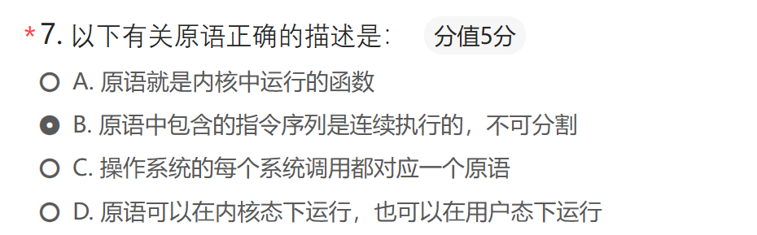

#### Fork()函数

例1
```c
#include <stdio.h>
#include <unistd.h>  // fork函数所在头文件

int main() {
    printf("进程启动，PID=%d\n", getpid());

    // 创建子进程
    pid_t pid = fork();

    if (pid < 0) {
        // 创建失败
        perror("fork失败");
    } 
    else if (pid == 0) {
        // 子进程执行这里
        printf("我是子进程，PID=%d，父PID=%d\n", getpid(), getppid());
    } 
    else {
        // 父进程执行这里
        printf("我是父进程，PID=%d，子PID=%d\n", getpid(), pid);
    }

    return 0;
}
```

输出

```
进程启动，PID=20739
我是父进程，PID=20739，子PID=20740
我是子进程，PID=20740，父PID=20739
```

fork调用的一个奇妙之处就是它仅仅被调用一次，调用成功时却能够返回两次，它可能有三种不同的返回值：
1) 在父进程中，fork返回**新创建子进程的进程ID**；
2) 在子进程中，fork返回0；
3) 如果出现错误，fork返回一个负值；

例2

```c
char str[10];
int fd = open("file.txt", O_RDWR);
if (fork() == 0) {
    // 子进程
    ssize_t cnt = read(fd, str, 10);
    printf("Child process: %s\n", str);
} else {
    // 父进程
    ssize_t cnt = read(fd, str, 10);
    printf("Parent process: %s\n", str);
}
```

输出

```
Parent process: abcdefghij
Child process: klmnopqrst
```

fd虽然被复制，但指向同一个文件结构体，所以两个进程共享了同一个指向文件的结构体
父子进程会**共享偏移量和状态**

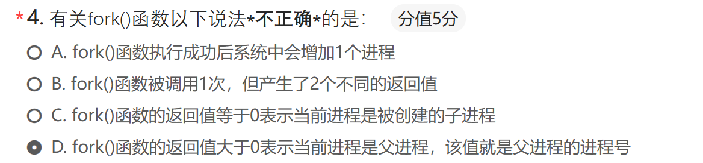

#### 进程状态

进程的三种基本状态
- 就绪状态：进程已获得除处理机外的所需资源，等待分配处理机资源；只要分配CPU就可执行。
- 执行状态：占用处理机资源；处于此状态的进程的数目小于等于CPU的数目。在没有其他进程可以执行时（如所有进程都阻塞），通常会自动执行系统的idle进程（相当于空操作）。
- 阻塞状态：正在执行的进程，由于发生某种事件而暂时无法执行，便放弃处理机处于阻塞状态。

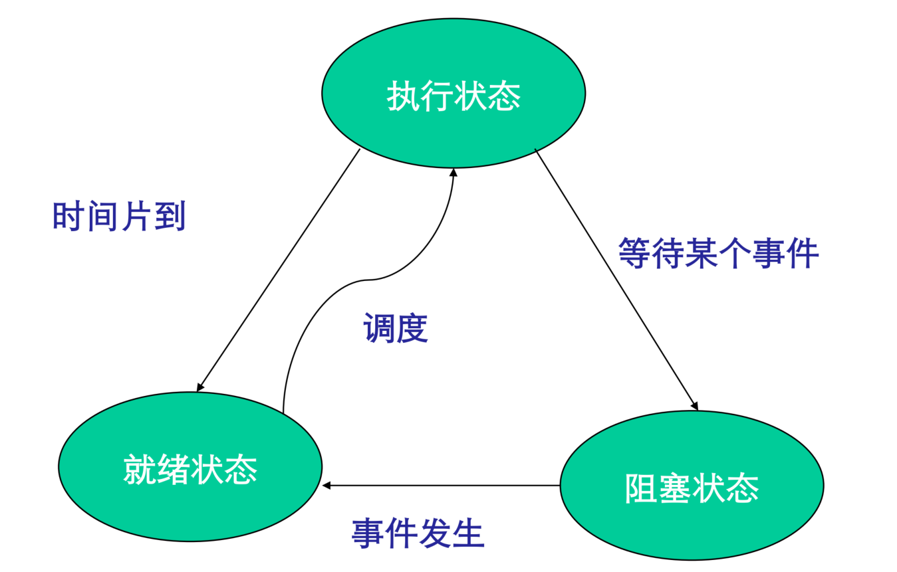

就绪 $\rightarrow$ 运行
- 调度程序选择一个进程运行

运行 $\rightarrow$ 就绪
- 运行进程用完了时间片
- 运行进程被中断，因为一高优先级进程处于就绪状态（抢占式调度）

运行 $\rightarrow$ 阻塞
- 当一进程所需的资源必须等待时
- OS尚未完成服务
- 对一资源的访问尚不能进行
- 初始化 I/O 且必须等待结果
- 等待某一进程提供输入(IPC)

阻塞 $\rightarrow$ 就绪
- 当等待的事件发生时

> 就绪 $\rightarrow$ 阻塞能否发生？
> 只有运行的进程才能阻塞。就绪的进程无法执行I/O或其他引发阻塞的操作。

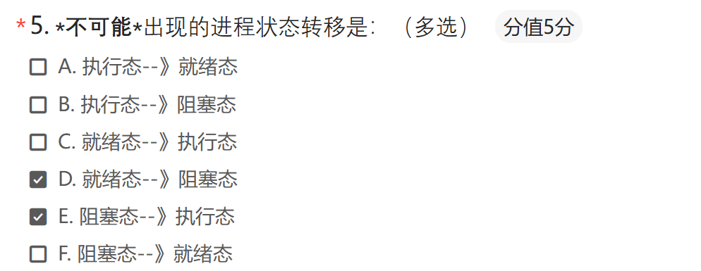

#### 进程控制

##### 进程控制块 PCB

系统为每个进程定义了一个数据结构：进程控制块 PCB（Process Control Block）。

作用：
- 实现进程创建、撤消；
- 包含进程唯一标志；
- 限制系统进程数目。

内容：

进程标识符(PID)
程序和数据地址
当前状态：
- 为了管理的方便，系统设计时会将相同的状态的进程组成一个**队列**，如就绪进程队列。
- 等待进程则要根据等待的事件组成多个等待队列，如等待打印机队列、等待磁盘I/O完成队列等等。

现场保护区：
- 当进程因某种原因不能继续占用CPU时（等待打印机），释放CPU，这时就要将CPU的各种状态信息保护起来（如**寄存器**），再次得到处理机，恢复CPU的各种状态，继续运行。

同步与互斥机制
优先级
资源清单：如拥有的I/O设备，打开的文件列表等
链接字：即指向队列中下一个进程PCB的首地址的指针
其他信息：进程记账信息，进程占用CPU的时间等。

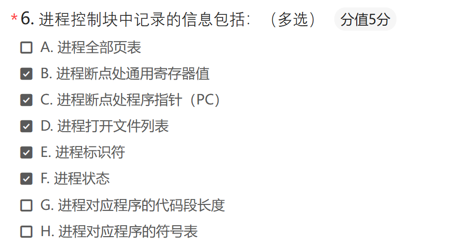

具体代码实现：

```c
struct Env {
    struct Trapframe env_tf;	 // saved context (registers) before switching
	LIST_ENTRY(Env) env_link;	 // intrusive entry in 'env_free_list'
	u_int env_id;			 // unique environment identifier
	u_int env_asid;			 // ASID of this env
	u_int env_parent_id;		 // env_id of this env's parent
	u_int env_status;		 // status of this env
	Pde *env_pgdir;			 // page directory
	TAILQ_ENTRY(Env) env_sched_link; // intrusive entry in 'env_sched_list'
	u_int env_pri;			 // schedule priority
}
```

env_tf : Trapframe 结构体的定义在 include/trap.h 中在发生进程调度或当陷入内核时，会将当时的进程上下文环境保存在 env_tf 中。
env_link : env_link 和 env_free_list来构造空闲进程表
env_id : 进程独一无二的标识符。
env_parent_id : 存储了创建本进程的父进程id。这样父子进程之间关联可以形成一棵进程树。
env_status : 进程状态
- ENV_FREE : 表明进程是不活动的，即进程控制块处于进程空闲链表中。
- ENV_NOT_RUNNABLE : 表明进程处于阻塞状
- ENV_RUNNABLE : 进程处于执行状态或就绪状态即其可以是正在运行也可以是正在等待调度。

env_pgdir : 进程页目录的内核虚拟地址。
env_cr3 : 进程页目录的物理地址。
env_sched_link : 用于构造调度队列。
env_pri : 保存进程的优先级。

#### PCB 组织方式

线性表
索引方式
链接方式：系统按照进程的状态将进程的PCB组成队列，从而形成就绪队列、阻塞队列、运行队列等。

#### 中断处理触发的进程切换流程

中断处理 = 当前程序暂停 $\rightarrow$ 保存现场 $\rightarrow$ 处理中断数据 $\rightarrow$ 可能切换进程 $\rightarrow$ 恢复进程执行

**与陷入内核的不同**

用户态 $\rightarrow$ 内核态 $\rightarrow$ 执行 $\rightarrow$ 返回用户态
同一个进程，地址空间不变，只需要保存PC/PSW少量寄存器

进程 A $\rightarrow$ 进程 B
保存所有寄存器，**地址空间切换(页表,TLB刷新)**，PCB以及调度队列的更新

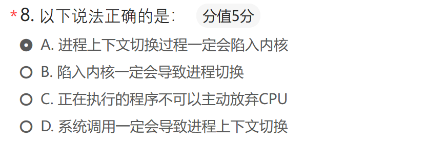

进程上下文切换是由操作系统内核完成的操作，需要修改 CPU 寄存器、页表、PCB 等关键数据，这些操作都属于内核态特权指令，用户态进程无法直接执行。因此，进程切换必须通过系统调用 / 中断陷入内核，由内核完成调度与切换。
大部分系统调用处理完成后，会直接返回原进程继续执行，不会发生进程切换。

## 线程

### 线程概念

进程的不足：
- 一个进程只能在一个时间干一件事，如果想同时干两件事或多件事，进程就无能为力了。
- 进程之间切换开销很大。
- 多个进程共享数据或通讯开销很大

进程包含了两个概念：资源拥有者和可执行单元。操作系统将资源拥有者称为进程（process, task），可执行单元称为线程（Thread）。
线程也称为轻量级进程 将资源与计算分离，提高并发效率。

> 进程与线程的区别
> 1. 基本单位不同
>    - 进程：资源分配的基本单位
>    - 线程：CPU 调度与执行的基本单位
> 2. 资源拥有情况
>    - 进程拥有独立的地址空间、内存、文件描述符、打开的文件等**完整资源**。
>    - 线程**不独立拥有资源**，共享所属进程的地址空间、数据段、堆、文件等，只拥有自己的栈、程序计数器、寄存器等少量私有信息。
> 3. 切换开销
>    - 进程切换：开销大，需要切换页表、刷新 TLB、保存完整上下文。
>    - 线程切换：开销小，只需保存和恢复执行上下文（寄存器和栈）。
> 4. 通信与同步
>    - 进程间通信（IPC）复杂：管道、消息队列、共享内存、信号量等。
>    - 线程间通信简单：直接读写进程的全局变量、堆数据即可，但需要同步（互斥锁、条件变量等）。
> 5. 独立性与健壮性
>    - 进程相互独立，一个进程崩溃一般**不会影响其他进程**。
>    - 同一进程内的线程共享资源，一个线程崩溃（如段错误）**通常会导致整个进程崩溃**。

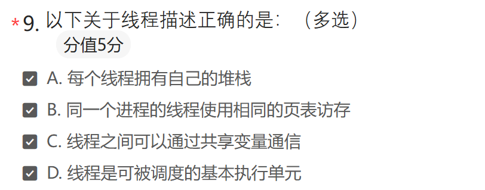

引入进程好处 多个程序可以并发执行，改善资源使用率，提高系统效率
引入线程好处 减少并发程序执行时所付出的时空开销，使得并发粒度更细、并发性更好

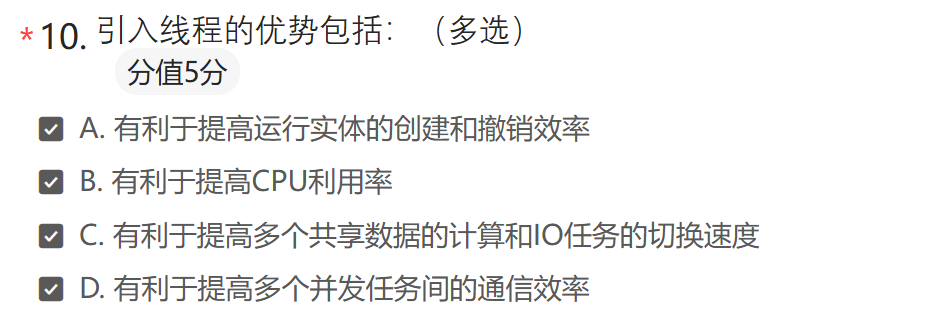

### 线程的实现方式

#### 用户级线程

#### 内核级线程

# 进程同步

## 同步与互斥问题

间接相互制约，主要原因是资源共享。
直接相互制约，主要源于进程合作。

进程同步：指多个相关进程在执行次序上的协调，用于保证这种关系的相应机制称为同步机制。
数据竞争：多个进程同时访问同一个共享变量，并且至少有一个是写。

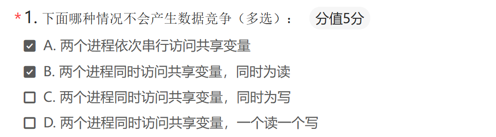

### 临界区

一次只允许一个进程使用的资源称为临界资源。例如打印机、共享变量。
对临界资源（如共享变量）进行访问的程序片段称为临界区

#### 临界区解决方案需要满足的条件

任何两个进程都不能同时进入临界区；
• 基本要求
不能事先假定CPU的个数和运行速度；
• 对并发硬件无限制
临界区外的进程不能妨碍其他的进程进入临界区；
• 对临界区的互斥访问仅仅发生在临界区内
一个进程不能在临界区外无限等待
• 公平

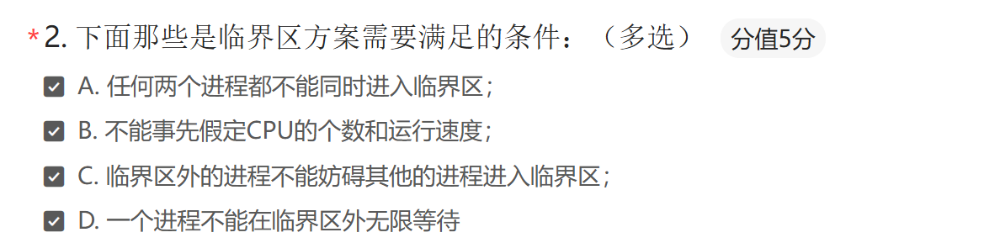

#### 同步机制应遵循的准则

空闲让进：临界资源处于空闲状态，允许进程进入临界区；临界区内仅有一个进程执行

忙则等待：有进程正在执行临界区代码，所有其他进程则不可以进入临界区

有限等待：对要求访问临界区的进程，应在保证在有限时间内进入自己的临界区，避免无限等。

让权等待：当进程（长时间）不能进入自己的临界区时，应立即释放处理机，尽量避免忙等耗费CPU资源。

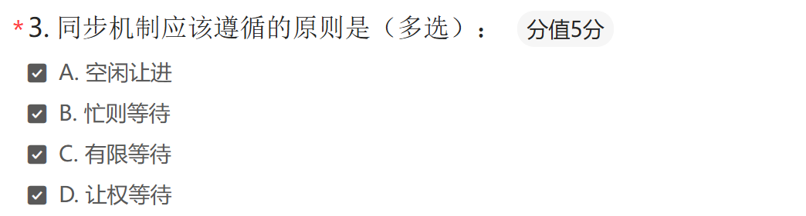

## 基于忙等待的互斥方法

### 简单尝试

#### 屏蔽中断

进入临界区关闭中断，离开临界区打开中断
临界区中可以独自访问共享变量
时钟中断和各种外设的中断会关闭
抢占式调度无法工作，当前进程可能独占CPU 
*进程可以通过阻塞的系统调用或者yield放弃CPU*

#### 共享锁变量

锁变量：设置共享变量lock
锁：0表示临界区无进程，1表示临界区有进程
锁变量初始值0
进程要进入临界区，测试（read）这把锁，如果锁的值为0，进程就将其设置(write)为1，并进入临界区
如果锁已经为1，则需要等待其变为0

问题：如何保证锁变量访问自身的原子性？（读取和设置必须是原子操作）

#### 严格轮换法-翻牌子

设立一个公用整型变量 turn：描述允许进入临界区的进程标识
- 在进入临界区循环检查是否允许本进程进入：turn为0时，进程0可进入；turn为1时，进程1可进入；
- 在退出区修改允许进入进程标识：进程0退出时，改turn为1；进程1退出时，改turn为0

问题
- 强制轮流进入临界区，没有考虑进程的实际需要。效率较低
- 违反规则：一个进程可能被一个不在临界区的进程阻止进入临界区

#### Peterson算法

略

> Peterson算法在抢占式和非抢占式调度下都可行么？
> 抢占式OK.非抢占式No:可能先运行进程霸占CPU。


#### 硬件指令机制

Test and Set Lock指令
- IBM370系列机器中称为**TSL**；在INTEL8086中称为**XCHG**指令。
- TSL：将lock变量读入寄存器，然后置位1
- 测试（读）并加锁（写）：**保证读写是一个原子操作**
- 实现：执行TSL指令的CPU会通过锁住内存总线，禁止其他CPU访问内存

#### 问题--优先级反转

Peterson，TSL XCHG算法的问题：
如果不能满足进入临界区条件，都要进行**忙等**
忙等，不仅仅浪费CPU时间还会导致**优先级反转**

低优先级任务先拿到了锁（进入临界区）
高优先级任务想要这把锁，被阻塞 / 忙等
调度器会抢占低优先级任务的 CPU，让高优先级任务运行
→ 结果：低优先级任务没法释放锁，高优先级任务一直等，被 “反转” 成了实际的低优先级。

### 生产者－消费者问题

若干进程通过有限的**共享缓冲区**交换数据。其中，“生产者”进程不断写入，而“消费者”进程不断读出；共享缓冲区共有N个；任何时刻只能有一个进程可对共享缓冲区进行操作。

简单的（但有问题的）实现：
- 当缓冲区满，让生产者睡眠，等待消费者取出数据再唤醒生产者
- 当缓冲区空，让消费者睡眠，等待生产者放入数据再唤醒消费者
- 使用count变量来追踪缓冲区满或者空的状态

## 基于信号量的方法

### 信号量机制

新的变量类型Semaphore（信号量）
`S >= 0` 表示当前可用的资源的数目
对信号量P(S)&V(S)操作原语。
P: down/wait/获取资源 V：up/signal/释放资源
S的初值
- `S=1` 实现互斥：二元信号量(等于mutex)
- `S>1` 实现同步：通用信号量

信号量使用：
必须置一次且只能置一次初值（代表资源的个数）
只能由P、V操作来改变
P/V操作是原语：原子操作不会被打断

#### 物理意义

P（down）操作分配资源：检查信号量初值是否大于0，如果大于0，减1，继续执行；如果等于0，进程被直接阻塞（将当前进程从运行队列移动到信号量的队列），减1的操作暂时不做。
- P是原子操作：一组操作，要么都执行，要么都不执行
- 当S=1，A和B同时调用P(S), 只有一个进程能够完成P(S)继续执行

当进程执行P操作阻塞到某个信号量，进程不在运行态，所以在唤醒前都不会占用CPU资源

V（up）操作释放资源：首先将信号量S增加1 (原子操作)。但是如果有一个或者多个进程在信号量的队列睡眠（这时S=1），就会随机唤醒一个进程（将进程从信号量的队列移入就绪队列），并使得其运行后能完成P操作的减1，所以最终S还是0。
- V(S)原子操作
- 实现时，操作前关闭中断，操作后打开中断。
- 注意 V(S) != S=S+1
- 如果S=6，进程A，B任意顺序调用V(S), 那么结果**一定**是8

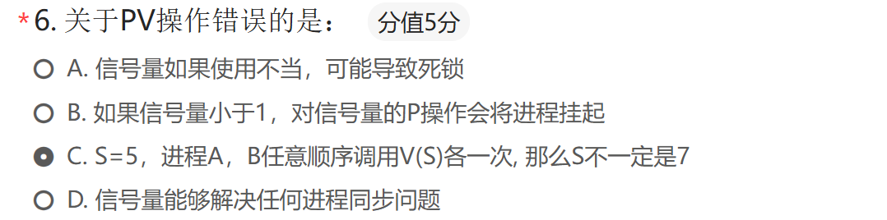

#### 实现

数据结构：一个整数+一个队列

对于单CPU系统；
- 系统在关闭中断的情况下，测试信号量，更新信号量，将进程睡眠或者唤醒。

对于多CPU系统：
- 需要有一个锁变量来保护信号量，并使用TSL指令或者XCHG指令来访问锁变量，从而保证每次只能有一个CPU检查信号量

#### 信号量机制解决生产者消费者问题

```c
#define N 100                  /* number of slots in the buffer */
typedef int semaphore;         /* semaphores are a special kind of int */
semaphore mutex = 1;           /* controls access to critical region */
semaphore empty = N;           /* counts empty buffer slots */
semaphore full = 0;            /* counts full buffer slots */

void producer(void)
{
    int item;

    while (TRUE) {             /* TRUE is the constant 1 */
        item = produce_item(); /* generate something to put in buffer */
        down(&empty);          /* decrement empty count */
        down(&mutex);          /* enter critical region */
        insert_item(item);     /* put new item in buffer */
        up(&mutex);            /* leave critical region */
        up(&full);             /* increment count of full slots */
    }
}

void consumer(void)
{
    int item;

    while (TRUE) {             /* infinite loop */
        down(&full);           /* decrement full count */
        down(&mutex);          /* enter critical region */
        item = remove_item();  /* take item from buffer */
        up(&mutex);            /* leave critical region */
        up(&empty);            /* increment count of empty slots */
        consume_item(item);    /* do something with the item */
    }
}
```

注意不能将down(&mutex)放在down(&empty)之前，否则可能会导致死锁：如果缓冲区是满的，生产者先将mutex设置为0，然后会阻塞在empty。这时消费者访问缓冲区，会对mutex执行P操作，就会阻塞在mutex。

### 信号量用法

#### 信号量用于互斥

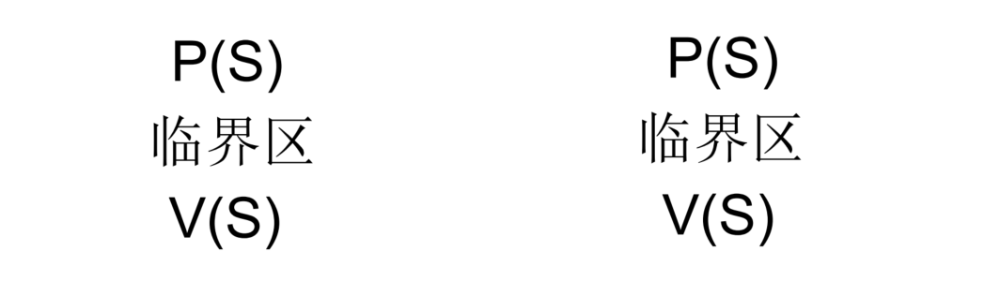

初值S=1,等价于锁

#### 信号量同步

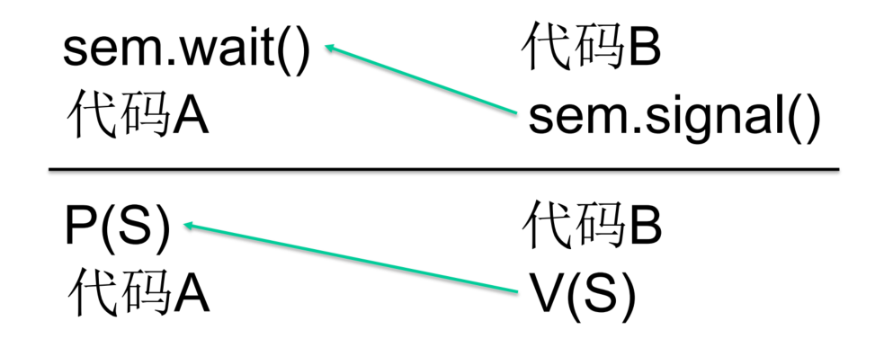

初值S=0; 代码B $\rightarrow$ 代码A

#### 信号量实现汇合

使用信号量实现线程A和线程B的汇合(Rendezvous)。使得a1永远在b2之前，而b1永远在a2之前。

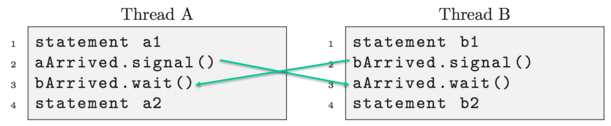

#### 使用信号量实现多路复用

实现mutex的泛化，使得n个线程能够同时运行在临界区，有时候也称为限流阀。

```c
Semaphore multiplex = n
    P(multiplex)
    critical section
    V(multiplex)
```

#### 使用信号量实现屏障

用信号量实现n个线程的屏障（Barrier）。使得所有线程都到达某个点之后才能继续执行。

```c
n = the number of threads
count = 0 //到达汇合点的线程数
semaphore mutex = 1 //保护count
semaphore barrier = 0//线程到达之前都是0或者负值。到达后取正值

P(mutex)
count = count + 1
V(mutex)

if count == n: V(barrier) # 第n个进程到来，唤醒一个线程，触发
P(barrier) # 前n-1个进程在此排队
V(barrier) # 一旦线程被唤醒，有责任唤醒下一个线程
```

### “信号量集”机制

```c
Process A:
  P(Dmutex);
  P(Emutex);
Process B:
  P(Emutex);
  P(Dmutex);
Dmutex, Emutex = 1;
Process A: P(Dmutex);
Process B: P(Emutex);
Process A: P(Emutex);
Process B: P(Dmutex);
```

需要同时获取两个或多个临界资源时，就可能出现由于各进程分别获得部分临界资源并等待其余的临界资源的**死锁**局面

#### AND型信号量集机制

将进程需要的所有共享资源一次全部分配给它；待该进程使用完后再一起释放。

#### 一般“信号量集”机制

基本思想：在AND型信号量集的基础上进行扩充：进程对信号量Si的测试值为ti（用于信号量的判断，即Si >= ti，表示资源数量低于ti时，便不予分配），资源的申请量为di（用于信号量的增减，即Si = Si - di和Si = Si +di）

```pascal
SP(S1, t1, d1, … , Sn, tn, dn)
  if S1>=t1 and … and Sn>=tn then
    for I :=1 to n do
      Si := Si - di;
    endfor
  else
    wait in Si;
  endif

SV(S1, d1, … ,Sn, dn)
  for I :=1 to n do
    Si := Si + di;
    wake waited process
  endfor
```

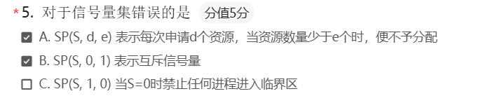

### 互斥量 (Mutex)

### 条件变量 (Condition Variable)

## 基于管程的同步与互斥

管程：把分散的临界区集中起来，为每个临界资源设计一个专门机构来统一管理各进程对该资源的访问，这个专门机构称为管程。
管程可以函数库的形式实现。相比之下，管程比信号量易于使用。
管程是一种**高级同步原语**。

### 管程的实现

对于共享资源，管程需要提供互斥的访问和同步的机制
管程的机制保证**只有一个进程在管程内执行**(互斥)
同步机制使用
- wait和signal，两个同步变量

```pascal
monitor ProducerConsumer
    condition full, empty;
    integer count;

    procedure insert(item: integer);
    begin
        if count = N then wait(full);
        insert_item(item);
        count := count + 1;
        if count = 1 then signal(empty)
    end;

    function remove: integer;
    begin
        if count = 0 then wait(empty);
        remove := remove_item;
        count := count - 1;
        if count = N - 1 then signal(full)
    end;

    count := 0;
end monitor;

procedure producer;
begin
    while true do
    begin
        item = produce_item;
        ProducerConsumer.insert(item)
    end
end;

procedure consumer;
begin
    while true do
    begin
        item = ProducerConsumer.remove;
        consume_item(item)
    end
end;
```

### Java中的管程实现

```java
public class ProducerConsumer {
    static final int N = 100; // constant giving the buffer size
    static producer p = new producer(); // instantiate a new producer thread
    static consumer c = new consumer(); // instantiate a new consumer thread
    static our_monitor mon = new our_monitor(); // instantiate a new monitor

    public static void main(String args[]) {
        p.start(); // start the producer thread
        c.start(); // start the consumer thread
    }

    static class producer extends Thread {
        public void run() { // run method contains the thread code
            int item;
            while (true) { // producer loop
                item = produce_item();
                mon.insert(item);
            }
        }
        private int produce_item() { ... } // actually produce
    }

    static class consumer extends Thread {
        public void run() {
            int item;
            while (true) {
                item = mon.remove();
                consume_item(item);
            }
        }
        private void consume_item(int item) { ... } // actually consume
    }

    static class our_monitor { // this is a monitor
        private int buffer[] = new int[N];
        private int count = 0, lo = 0, hi = 0; // counters and indices

        public synchronized void insert(int val) {
            if (count == N) go_to_sleep(); // if the buffer is full, go to sleep
            buffer[hi] = val; // insert an item into the buffer
            hi = (hi + 1) % N; // slot to place next item in
            count = count + 1; // one more item in the buffer now
            if (count == 1) notify(); // if consumer was sleeping, wake it up
        }

        public synchronized int remove() {
            int val;
            if (count == 0) go_to_sleep(); // if the buffer is empty, go to sleep
            val = buffer[lo]; // fetch an item from the buffer
            lo = (lo + 1) % N; // slot to fetch next item from
            count = count - 1; // one few items in the buffer
            if (count == N - 1) notify(); // if producer was sleeping, wake it up
            return val;
        }

        private void go_to_sleep() {
            try {
                wait();
            } catch (InterruptedException exc) {}
        }
    }
}
```

### 管程优缺点

依赖于编译器支持，和特定语言相关
不适用于分布式系统，仅仅适用于单核或者多核的**共享内存**系统

> 原因：管程把共享数据 + 互斥访问 + 条件同步 封装，依赖**共享内存、原子操作、即时调度**（同步阻塞/唤醒）
> 而分布式系统没有共享内存


## 进程通信的主要方法（IPC）

低级通信：只能传递状态和整数值（控制信息），包括进程互斥和同步所采用的**信号量**和**管程**机制。缺点：
- 传送信息量小：效率低，每次通信传递的信息量固定，若传递较多信息则需要进行多次通信。
- 编程复杂：用户直接实现通信的细节，编程复杂，容易出错。

高级通信：能够传送任意数量的数据，包括三类：**管道、共享内存、消息系统**等。


### 管道通信(Pipe)

管道是用于连接读进程和写进程以实现两个进程通信的**共享文件**，又称管道文件。
Unix系统中，管道分为有名管道和无名管道。
- 无名管道：`sort < file1 |grep sth_to_search`
- 有名管道：`mkfifo()`函数创建

#### 无名管道 (Pipe)

实例：杀死一个叫conky的进程

```
ps aux | grep conky| grep -v grep | awk '{print $2}' | xargs kill
```

管道是半双工的，**数据只能向一个方向流动**；需要双方通信时，需要建立起两个管道；

无名管道**只能用于父子进程或者兄弟进程之间**（具有亲缘关系的进程）；

单独构成一种独立的文件系统：管道对于管道两端的进程而言，就是一个文件，但它不是普通的文件，它不属于某种文件系统，而是自立门户，单独构成一种文件系统，并且只存在在内存中。

数据的读出和写入：一个进程向管道中写的内容被管道另一端的进程读出。写入的内容每次都添加在管道缓冲区的末尾，并且每次都是从缓冲区的头部读出数据。

#### 有名管道（Named Pipe或FIFO）

无名管道应用的一个重大限制是它没有名字，因此，只能用于具有亲缘关系的进程间通信，在有名管道提出后，该限制得到了克服。

FIFO不同于管道之处在于它提供一个路径名与之关联，以FIFO的文件形式存在于文件系统中。这样，即使与FIFO的创建进程不存在亲缘关系的进程，**只要可以访问该路径**，就能够彼此通过FIFO相互通信。

需注意的是，FIFO严格遵循**先进先出**（first in first out），对管道及FIFO的读总是从开始处返回数据，对它们的写则把数据添加到末尾。


### 消息传递（message passing）

略

## 经典的进程同步与互斥问题

### 柜员-顾客

#### 代码1：基于信号量同步

```c
int cstmr_cnt = 0; //下一个要服务的客户
Semaphore s_mutex=1;//服务器进程互斥访问cstmr_cnt
Semaphore next_cstmr = 0; //客户服务器进程同步

process customer i
Begin
    v(next_cstmr);
end

process servers i(i=1,...,n)
begin
    while(true){
        p(s_mutex);
        p(next_cstmr);
        cstmr_cnt ++;
        v(s_mutex);
        为持有next_cstmr的客户服务;
    }
end
```

这里servers进程里有 `p(next_cstmr)`，是等待customer来唤醒它

## 代码2：基于忙等同步

```c
int cstmr_id = 0;  //当前客户编号
semaphore mutex=1; //对cstmr_id互斥访问
int next_cstmr = 0; //下一个要服务客户编号
semaphore s_mutex=1; //服务器进程互斥访next_cstmr

process customer i
Begin
    p(mutex);
        cstmr_id ++;
    v(mutex);
end

process servers i(i=1,...,n)
begin
    while(true){
        p(s_mutex);
        p(mutex);
        if(next_cstmr < cstmr_id)
            next_cstmr ++;
        v(mutex)
        v(s_mutex);
        为next_cstmr号码持有者服务;
    }
end
```

这里servers进程是一直循环检查条件是否成立

### 构建水分子(H2O)问题

```c
oxygen = 0      // 氧原子计数器：记录当前有多少个氧线程准备就绪
hydrogen = 0    // 氢原子计数器：记录当前有多少个氢线程准备就绪
Semaphore mutex = 1  // 互斥锁：保护oxygen、hydrogen计数器，避免多线程同时修改
Barrier barrier(3)   // 屏障：必须等3个线程（1O+2H）都到达这里，才会一起放行
Semaphore oxyQueue = 0   // 氧线程的等待队列：氧原子不够条件时，在这里阻塞等待
Semaphore hydroQueue = 0 // 氢线程的等待队列：氢原子不够条件时，在这里阻塞等待

// 氧气线程

P(mutex)              // 加锁，保护计数器
oxygen += 1           // 氧原子就绪数+1

if hydrogen >= 2:     // 如果当前已经凑齐了≥2个氢原子
    V(hydroQueue)     // 唤醒1个等待的氢线程（发信号：可以来生成水了）
    V(hydroQueue)     // 再唤醒第2个等待的氢线程
    hydrogen -= 2     // 消耗掉2个氢原子名额
    V(oxyQueue)       // 唤醒自己（氧线程），让自己也能继续执行
    oxygen -= 1       // 消耗掉1个氧原子名额
else:                 // 氢原子还不够2个
    V(mutex)          // 先释放锁，让其他线程可以修改计数器

P(oxyQueue)           // 氧线程在这里阻塞，等待被唤醒
bond()                // 模拟“生成水分子”的动作
barrier.wait()        // 等3个线程（1O+2H）都到齐，再一起放行
V(mutex)              // 最后释放锁

// 氢气线程

P(mutex)              // 加锁，保护计数器
hydrogen += 1         // 氢原子就绪数+1

if hydrogen >= 2 and oxygen >= 1:  // 同时满足：氢≥2 且 氧≥1
    V(hydroQueue)     // 唤醒1个等待的氢线程
    V(hydroQueue)     // 再唤醒第2个等待的氢线程（包括自己）
    hydrogen -= 2     // 消耗2个氢名额
    V(oxyQueue)       // 唤醒1个等待的氧线程
    oxygen -= 1       // 消耗1个氧名额
else:                 // 条件不满足，凑不齐1O+2H
    V(mutex)          // 先释放锁，让其他线程可以修改计数器

P(hydroQueue)         // 氢线程在这里阻塞，等待被唤醒
bond()                // 模拟“生成水分子”的动作
barrier.wait()        // 等3个线程（1O+2H）都到齐，再一起放行
```


