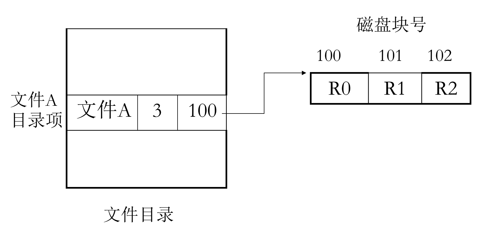
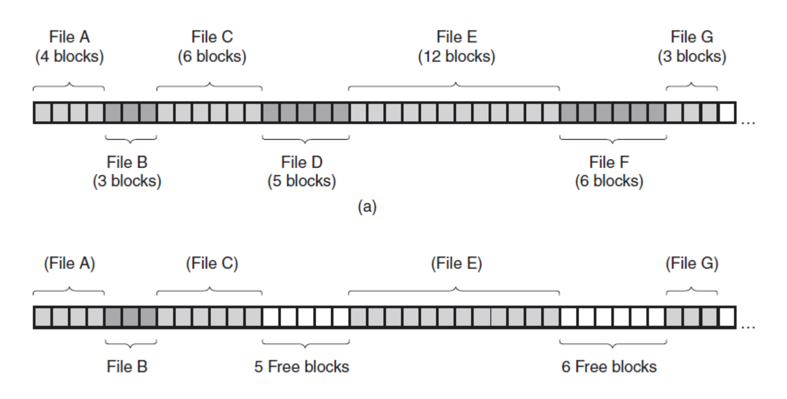
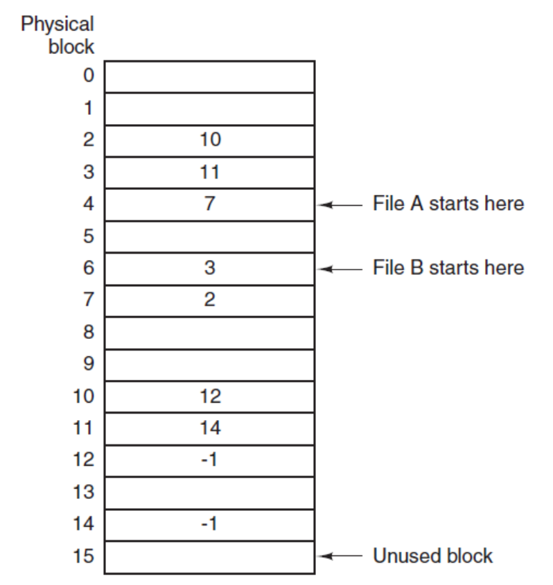

# 文件系统

## 文件系统基本概念

### 数据的持久化存储

进程运行时可以把数据暂时保存在自己的地址空间中，但这种方式有明显局限：
- 地址空间大小有限；
- 进程结束后，数据会丢失；
- 不便于多个进程长期共享。

因此，计算机必须把部分数据保存在磁盘、SSD、光盘等外部存储设备上，以满足：
- 大量存储；
- 长期保存；
- 多进程共享。

### 文件的概念

文件（File）是带有标识（文件名）的、在逻辑上具有完整意义的信息项序列。

可以从两个角度理解文件：
- 从用户角度：文件是一个有名字的字节序列；
- 从文件系统角度：文件是磁盘块的有组织集合。

文件通常包括两部分：
- 文件体：文件的实际内容；
- 文件说明：管理该文件所需的信息，如文件名、物理地址、大小、权限、时间戳等。

#### 文件的本质

文件本质上是一种抽象机制。

操作系统中的典型抽象：
- 进程是对 CPU 的抽象；
- 虚拟地址空间是对内存的抽象；
- 文件是对磁盘等持久化存储的抽象。

文件把底层复杂的存储细节隐藏起来，使用户看到的是一个独立的、连续的逻辑地址空间，其大小就是文件大小，与进程地址空间无关。

#### 一切皆文件

文件的本质是一组字节序列，因此很多 I/O 设备也可以被视为字节流的载体：
- 字符设备；
- 块设备；
- 网络设备。

这就是现代操作系统中“一切皆文件”的基本思想。

### 文件管理与文件系统

#### 文件管理的需求

从用户视角看：
- 关心文件怎么命名；
- 关心如何创建、打开、关闭、读、写；
- 关心共享和保护；
- 不关心数据具体存放在磁盘哪里。

从操作系统视角看：
- 需要组织和管理物理文件；
- 需要维护目录、存储空间和元数据；
- 需要完成逻辑地址到物理地址的转换；
- 需要与设备管理和 I/O 系统对接。

#### 文件系统的定义

文件系统（File System）是操作系统中统一管理信息资源的软件，负责：
- 文件的存储；
- 文件的检索；
- 文件的更新；
- 文件共享；
- 文件保护；
- 用户接口提供。

#### 文件系统的任务

文件系统通常需要完成以下任务：
1. 统一管理磁盘空间，实现分配和回收；
2. 实现文件的按名存取；
3. 提供共享、保护和保密机制；
4. 向用户提供方便的操作接口；
5. 提高文件系统性能；
6. 提供与 I/O 系统的统一接口。

#### 文件系统模型

文件系统可以理解为多个层次模块的组合：
- 文件命令解释模块；
- 目录检索模块；
- 存取控制验证模块；
- 逻辑文件系统模块；
- 物理文件系统模块；
- 设备策略模块；
- I/O 控制模块。

#### 文件系统的三个层次

第一层：文件系统接口
- 命令行接口：用户通过命令与文件系统交互；
- 程序接口：用户程序通过系统调用访问文件系统。

第二层：文件管理的软件集合
- 存储空间管理；
- 目录管理；
- 逻辑块到物理块映射；
- 文件读写管理；
- 共享与保护。

第三层：文件系统管理对象
- 文件；
- 目录；
- 磁盘存储空间。

### 文件名、文件类型与文件属性

#### 文件名

创建文件时必须指定文件名，用户依靠文件名访问文件。

常见规则：
- 文件名是一个有限长度字符串；
- 常常由“文件名 + 扩展名”组成；
- 不同系统对最大长度、大小写是否敏感的规定不同。

#### 文件类型

可以从多个角度分类文件。

按性质和用途：
- 系统文件；
- 库文件；
- 用户文件。

按数据形式：
- 源文件；
- 目标文件；
- 可执行文件。

按保护级别：
- 只读文件；
- 读写文件；
- 执行文件；
- 不保护文件。

按逻辑结构：
- 有结构文件；
- 无结构文件。

按物理结构：
- 顺序文件；
- 链接文件；
- 索引文件。

#### UNIX 中的典型文件类型

UNIX 常见文件类型：
- 普通文件；
- 目录文件；
- 特殊文件（设备文件）；
- 管道文件；
- 套接字文件。

其中：
- 字符设备文件对应串行 I/O 设备；
- 块设备文件对应磁盘、磁带等；
- 管道和套接字体现了“把通信对象也抽象成文件”的思想。

### 文件的逻辑结构

#### 逻辑结构的含义

文件逻辑结构是从用户角度看到的文件组织方式，主要由访问需求决定。

典型形式：
- 字节流；
- 记录序列；
- 树形结构。

#### 流式文件与记录式文件

流式文件：
- 以字符或字节为基本单位；
- 文件内容是一串无结构的字节序列；
- 典型于文本文件、二进制文件。

记录式文件：
- 由若干记录组成；
- 每条记录有内部结构；
- 可以按记录读写、查找和修改。

#### 文件存取方式

常见存取方式：
- 顺序存取；
- 随机存取。

随机存取通常需要显式指定读写位置或偏移量。

#### 物理块

文件最终存放在外部存储设备上。磁盘、SSD 等设备通常被划分为大小相等的物理块（block）或簇（cluster）：
- 它们是存储、传输和分配的基本单位；
- 系统统一为这些块编号。

### 文件控制块与文件基本操作

#### 文件控制块 FCB

文件控制块（FCB, File Control Block）是操作系统为了管理文件而设置的数据结构。

它保存管理文件所需的各种元数据。在很多系统中，目录项本质上就是文件控制块的一种表现形式。

FCB 常见内容：
- 文件名；
- 文件号；
- 文件大小；
- 文件物理地址；
- 文件逻辑结构和物理结构；
- 创建时间、修改时间、访问时间；
- 所有者；
- 访问权限；
- 文件类型；
- 共享计数；
- 各种状态标志。

#### 文件基本操作

文件的常见操作包括：
- 创建 `create`；
- 删除 `delete`；
- 打开 `open`；
- 关闭 `close`；
- 读 `read`；
- 写 `write`；
- 追加 `append`；
- 定位 `seek`；
- 获取属性 `get attributes`；
- 设置属性 `set attributes`；
- 重命名 `rename`。

### 目录管理

#### 为什么需要目录

如果系统中文件很多，必须解决几个问题：
- 如何快速定位一个文件；
- 如何避免不同用户之间的命名冲突；
- 如何按用途、类型、课程、用户等进行分组。

目录就是为了解决这些问题而提出的。

#### 目录的定义

目录是由文件说明索引组成的、用于文件检索的特殊文件。

目录中保存的主要是文件访问和控制信息，而不是文件内容本身。

#### 目录项内容

目录项通常包含：
- 文件名；
- 文件类型；
- 文件位置；
- 文件长度；
- 所有者；
- 访问权限；
- 创建、读写时间等使用信息。

从这个意义上说：
- 目录项就是文件控制块；
- 目录文件是 FCB 的集合。

#### 目录操作

常见目录操作：
- 创建目录；
- 删除目录；
- 打开目录；
- 关闭目录；
- 读取目录项；
- 重命名目录；
- 建立链接；
- 删除链接。

### 文件目录的组织方式

#### 单级目录

单级目录是最简单的目录结构，所有文件都放在同一个目录下。

优点：
- 结构简单；
- 易于实现。

缺点：
- 文件多时查找慢；
- 文件名容易冲突；
- 不便于共享和分类管理。

#### 两级目录

两级目录的结构是：
- 根目录下按用户划分目录；
- 每个用户目录中存放该用户文件；
- 用户目录下不再继续细分。

优点：
- 适合多用户系统；
- 可避免不同用户间的重名问题。

缺点：
- 用户自己的文件仍然缺乏更细粒度分组。

#### 多级目录

多级目录（层次目录）是现代操作系统最常见的方式。

特点：
- 高层目录项指向下一级目录；
- 最后一层目录项指向实际文件；
- 形成一棵目录树。

优点：
- 层次清晰；
- 便于分类管理；
- 能解决文件重名问题；
- 便于不同用户和不同类别文件分别设置权限；
- 分级查找通常比单级目录更高效。

缺点：
- 当目录层次过深时，路径检索时间会增加。

#### 路径名

在多级目录中，访问文件需要路径名。

绝对路径名：
- 从根目录开始，逐级写出到目标文件的完整路径；
- 对同一文件是唯一的。

相对路径名：
- 相对于当前工作目录指定路径；
- 依赖于当前目录位置。

特殊目录：
- `.` 表示当前目录；
- `..` 表示上一级目录。

## 文件系统的实现方法

文件实现本质上要解决两个问题：
1. 如何描述一个文件，如何记录其管理信息；
2. 如何存放文件，如何记录逻辑块与物理块之间的映射关系。

第一个问题主要由 FCB/inode 等元数据结构解决。  
第二个问题主要由文件物理结构和块映射方式解决。

### 磁盘上文件系统的布局

典型的磁盘文件系统布局中，通常会包含：
- 引导块；
- 超级块；
- 空闲空间信息；
- inode/FCB 区；
- 数据区。

#### 超级块

超级块（superblock）记录文件系统整体特征，例如：
- 文件系统大小；
- 块大小；
- 空闲块数量；
- 已使用块数量；
- inode 信息等。

系统在挂载文件系统时通常需要读取超级块。

> 如果超级块损坏，文件系统往往无法被正常加载。

### 文件逻辑结构与物理结构

文件逻辑结构：
- 从用户角度看文件如何组织；
- 目的是提高检索效率、便于修改、降低使用复杂度。

文件物理结构：
- 表示文件在外存中的存放方式；
- 解决物理块组织和逻辑块映射问题。

常见物理结构：
- 连续文件；
- 链接文件；
- 索引文件。

### 连续文件

#### 基本思想

连续文件要求一个文件占用一组连续的物理块。

目录项中通常只需要记录：
- 起始块号；
- 占用块数。

因此，逻辑块号到物理块号的转换非常直接：物理块号 = 起始块号 + 逻辑块号

#### 优点

- 结构简单，实现容易；
- 不需要额外链接或索引空间；
- 支持顺序访问；
- 也支持随机访问；
- 顺序和随机访问速度都较快。

#### 缺点

- 文件长度不易动态增长；
- 创建时常需要预估大小；
- 预留空间可能浪费；
- 删除后容易产生外部碎片；
- 若需要扩展文件，可能必须整体搬移。

删除文件导致碎片化

> 连续文件适合长度变化不大、顺序访问为主的文件，如部分多媒体文件。

### 串联/链接文件

#### 基本思想

链接文件（串联文件）由若干离散物理块组成，每个物理块的最末一个字（或第一个字）作为指针，指出后继块的物理地址。

目录项中保存链首指针，最后一个块用空指针（“∧”）表示结束。

#### 优点

- 空间利用率高；能较好的利用辅存空间。
- 文件动态扩充和修改容易。
- 顺序存取效率高

#### 缺点

- 数据地址一起保存，随机存取效率太低，如果访问文件的最后的内容，实际上要访问整个文件。
- 可靠性问题，如指针出错
- 链接指针占用一定的空间

#### 使用内存表的串联文件结构

将所有链表的指针放入一个内存表：文件分配表（FAT）

优点
- 不用将数据和地址一起保存
- 随机访问相对串联系统快速
  - 不必访问磁盘读出每块数据

缺点
- 整个FAT必须在内存中
- 非常占用空间
  - 1TB磁盘，1KB 块大小，1 billion表项，3byte每项，2.4GB
- 随机访问仍然很慢 $O(n)$

### 索引文件

#### 基本思想

索引文件为每个文件建立索引块，索引块中记录该文件各逻辑块对应的物理块号。

目录项中只需记录索引块位置。

访问文件时：
- 先找到索引块；
- 再由索引块找到目标数据块。

#### 优点

- 支持高效随机访问；
- 文件块可以离散分布；
- 不必要求连续空间；
- 较适合大文件和频繁随机访问场景。

#### 缺点

- 需要额外索引块空间；
- 小文件可能显得开销偏大；
- 当文件很大时，可能需要多级索引。

## 文件系统实例分析

### 目录项与 inode 思想

很多 UNIX 类文件系统把“文件名”和“文件元数据”分开：
- 目录项保存文件名与 inode 编号的映射；
- inode 保存文件属性和数据块地址。

这样做的好处：
- 目录检索更灵活；
- 支持硬链接；
- 文件名与文件实际内容管理分离。

### 超级块、目录项与数据区的关系

一个完整文件系统通常同时维护：
- 超级块：记录全局信息；
- 目录项：完成名字到文件对象的映射；
- inode/FCB：记录元数据和块映射；
- 数据块：保存文件内容。

这几部分共同组成了文件系统的核心结构。

## 小结

本章主线可以概括为：
- 文件是对持久化存储的抽象，本质上是带名字的字节序列；
- 文件系统负责名字管理、空间管理、共享保护和用户接口；
- 目录是文件检索的核心机制，现代系统普遍采用多级目录；
- FCB/inode 用于记录文件元数据；
- 文件物理结构的经典实现有连续、链接、索引三类；
- 文件系统实现的关键，是把“文件名 + 偏移”转换成对应的物理块地址。
